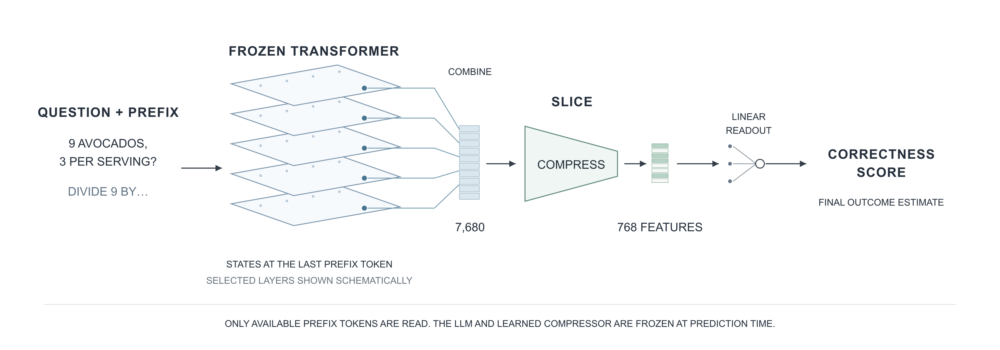
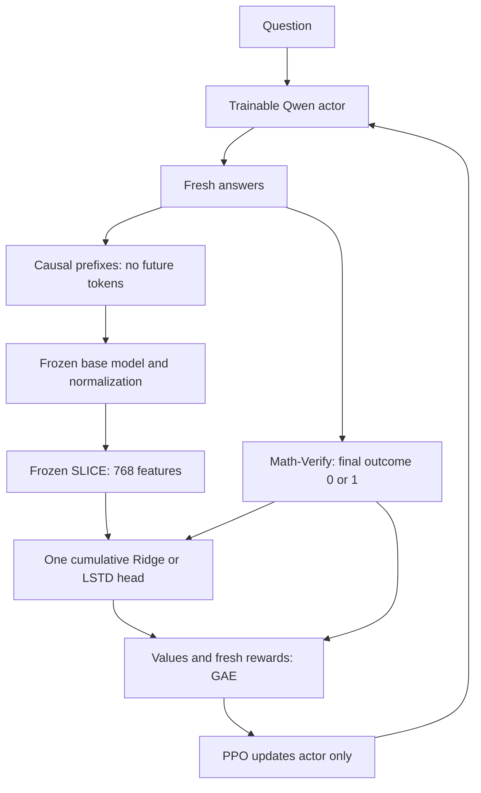

# SLICE: a compact critic for PPO

**A language model writes an answer. SLICE estimates whether a partial answer
will finish correctly, helping PPO decide which actions to reinforce.**

Our aim is cheaper value learning with a fixed feature basis. SLICE freezes a
copy of Qwen2.5-Math-1.5B and a learned sparse compressor. During PPO, a small
Ridge or LSTD head learns from verified outcomes through cumulative matrices
and regularized solves. The actor changes; the critic’s feature coordinates do not.

**Our accuracy-focused baseline is token-level SLICE + cumulative Ridge, with
one shared head and no output LayerNorm.** It reached **75.51% Numina actor
accuracy** in the latest five-seed comparison. This is a tested recipe, not a
universal accuracy, stability or total-cost guarantee.



Five selected blocks (28, 27, 25, 21, 13) supply **7,680 coordinates**, compressed
to **768 features**; an intercept gives a **769×769** head system. Per-block RMS
normalization and training-only centering/scalar scaling stay frozen. Sparse
activations still use dense kernels, and frozen encoder forward passes still cost compute.



The head retains raw `A,b` sums across updates. The actor uses fresh answers only;
there is no answer replay or critic-transformer backpropagation. Historical-policy
statistics remain uncorrected. Values estimate eventual reward; they do not
certify reasoning. [Algorithm and package boundaries](docs/ARCHITECTURE.md).

## Main results

| Completed study | Main finding |
|---|---|
| Token/chunk PPO, five seeds | Token SLICE **75.51%**, chunk SLICE **73.54%**. Chunking saved **11.7% online training GPUh** but lost **1.97 pp**, adjusted difference interval **[−3.29, −0.56] pp**. |
| Seven-critic PPO, three seeds | Ridge **73.97%**, tested PPO **72.65%**; Ridge used **17.3% less online training GPUh**. Its adjusted accuracy interval against PPO crossed zero. |
| Offline transfer, MATH with 100 target training questions | Transferred SLICE + refitted Ridge Brier **0.219051**, RMS-layer **0.228839**; difference interval **[−0.01490, −0.00445]**. |

These are **separate studies**, not a combined leaderboard. Actor accuracy measures
final problem-solving success; offline Brier measures prefix-prediction error
(lower is better). GPUh means GPU-hours, not elapsed hours. Online compute excludes
prior feature learning; total-cost and limited-data advantages remain task-dependent.

## Setup

SLICE is an **internal Python package**, not a hosted API or PyPI release. The
RL pipeline consumes its feature and cumulative-head interfaces.

For an existing Duke installation, before submitting a new study:

```bash
source scripts/cluster_env.sh
srun -p compsci --cpus-per-task=8 --mem=128G --time=00:45:00 --pty bash -i
source scripts/cluster_env.sh
bash scripts/container_exec.sh bash scripts/install_critic_package.sh
bash scripts/container_exec.sh "$PWD/.venv/bin/python" \
  scripts/check_slice_release.py --out outputs/slice-release-check-new
exit
```

Require `passed: true`; choose a new output directory each time. Never change code
or environments while queued/running studies use the checkout.
[First installation and local development](SETUP.MD) ·
[Package API](packages/slice-critic/API.md) ·
[Historical replay and fresh training](docs/REPRODUCING.md).

The v3 runtime still defaults to experimental chunk learning. For new online
runs using the recommended token recipe, set `experiment.chunking=token` before
sealing the study; worker settings follow it. Never edit an old manifest to change
its recipe. [Chunk protocol and recovery](docs/CHUNK_COMPARISON.md).

## Questions we tested

Each linked experiment begins with a question and a qualified answer, followed by
its setup, data and interpretation. **Offline prediction, online PPO and accounting
are different kinds of evidence.** Historical two-fold studies are explicitly
labeled. Smoke tests establish integration, not accuracy rankings. Older exploratory
implementations live in Git history; raw cluster outputs are not bundled here.

**Do multi-layer hidden states outperform J-lens and single-layer readouts?**
In this offline study, normalized multi-layer Ridge had Brier 0.18917 versus 0.18976 for full J-lens, 0.19702 for the two-thirds layer and 0.21306 for the final layer. PCA compression to 768 features worsened normalized multi-layer Brier to 0.20216.
[Experiment 01](experiments/01-representations-and-pca.MD).

**Does a learned 768-feature bottleneck preserve useful correctness signals?**
Yes: sparse 768 + Ridge reached Brier 0.18505 and 72.66% offline prediction accuracy, versus 0.20216 Brier for matched-width PCA. Plain and sparse compressors were close; sparsity did not establish a hardware speedup.
[Experiment 02](experiments/02-sparse-bottleneck-768.MD).

**Does a learned 1536-feature bottleneck preserve useful correctness signals?**
Yes: sparse 1536 + Ridge reached Brier 0.18489 and 72.71% offline prediction accuracy, versus 0.19773 Brier for matched-width PCA. Plain and sparse compressors were close; sparsity did not establish a hardware speedup.
[Experiment 03](experiments/03-sparse-bottleneck-1536.MD).

**Can frozen compressed features support PPO with cumulative linear critics?**
The short pilot supported the integration: sparse Ridge reached 70.95% actor accuracy versus 68.92% for the tested PPO baseline. With only three seeds and 60 updates, it did not settle method rankings.
[Experiment 04](experiments/04-focused-ppo-pilot.MD).

**Does sparse Ridge PPO compete with GRPO and a trainable transformer critic?**
Sparse Ridge had the highest mean actor accuracy, 74.60%, with 10.346 training GPUh versus PPO’s 73.52% and 12.513 GPUh (17.3% less online training compute). Its adjusted +1.08 pp interval against PPO crossed zero, so superiority over PPO was not established.
[Experiment 05](experiments/05-six-method-ppo.MD).

**Does the cleaned-up pipeline reproduce the earlier six-method pattern?**
Sparse Ridge again had the highest mean, 74.22%, versus 72.61% for two-thirds Ridge; the adjusted gain interval was [0.17, 3.19] pp. PPO’s mean changed to 69.93%, so the replay reproduced the main pattern rather than identical outcomes.
[Experiment 06](experiments/06-production-replay.MD).

**Does removing question-fold cross-fitting hurt our linear PPO critics?**
In the reported five-seed comparison, one-head SLICE + Ridge reached 75.16%, up 0.94 pp over its two-fold replay comparator. LSTD changes were near zero; this motivated one shared cumulative head, without proving same-sample fitting is unbiased.
[Experiment 07](experiments/07-one-head.MD).

**Does poor matrix conditioning explain why LSTD trails Ridge?**
Not by itself: at update 120, seed 301’s regularized SLICE Ridge matrix had condition number 3.06×10⁴, while LSTD’s was better conditioned at 2.70×10³. Better conditioning did not guarantee better actor learning.
[Experiment 08](experiments/08-conditioning.MD).

**Does adding LayerNorm after SLICE improve offline Ridge predictions?**
It improved raw Brier slightly, from 0.18346 to 0.18302, with both accuracies rounding to 73.2%. The regularized condition number rose from 3.04×10⁴ to 5.23×10⁹ at epsilon .01; no PPO benefit was tested.
[Experiment 09](experiments/09-feature-normalization.MD).

**Does stronger Ridge regularization materially improve the LayerNorm variant?**
Sweeping epsilon from .1 to 100 greatly improved SLICE + LayerNorm conditioning, but its displayed Brier stayed 0.18302 and accuracy stayed 73.2%. This was a conditioning improvement, not evidence of a meaningful prediction or PPO improvement.
[Experiment 10](experiments/10-ridge-epsilon.MD).

**Does an MLP readout improve offline predictions before extensive tuning?**
The frozen-SLICE MLP reached Brier 0.181589 versus raw Ridge’s 0.183459, but clipped Ridge was already 0.181007. Joint SLICE + MLP was weaker at 0.183017 in this initial three-seed pilot.
[Experiment 11](experiments/11-mlp-offline-pilot.MD).

**Does validation-tuned joint SLICE–MLP training clearly beat frozen Ridge?**
Joint training reached test Brier 0.180671 versus raw Ridge 0.183459 and clipped Ridge 0.181007. Its paired question-mean improvement over clipped Ridge had interval [−0.001019, +0.000453], so a clear gain beyond the bounded Ridge control was not established.
[Experiment 12](experiments/12-mlp-offline-tuned.MD).

**Do neural heads or low-lambda LSTD improve PPO over cumulative Ridge?**
Ridge led the seven-arm means at 73.97%, versus 72.23% for frozen-SLICE MLP and 72.75% for joint SLICE–MLP. LSTD(.99) was close at 73.62%; LSTD(.05) fell to 70.22%, so neither a neural head nor low lambda improved this recipe.
[Experiment 13](experiments/13-seven-critic-ppo.MD).

**Does transferring a full critic beat refitting its head or combining multiple SLICEs?**
On GSM8K, Numina SLICE + refitted Ridge improved question-mean Brier to 0.204976 from 0.216804 for the transferred full critic. Joint-data SLICE scored 0.206014 and the 768-feature combined system 0.223276; the RMS two-thirds control was best at 0.201330.
[Experiment 14](experiments/14-transfer-and-ensembling.MD).

**Does transferred SLICE help when target-domain labels are scarce?**
The clearest gain was MATH with 100 training questions: transferred SLICE Brier 0.219051 versus RMS-layer 0.228839, difference interval [−0.01490, −0.00445]. At 2,000 questions it was essentially tied on MATH and worse on GSM8K, so the low-data benefit was task-dependent.
[Experiment 15](experiments/15-transfer-learning-curves.MD).

**Have we established an end-to-end cost advantage for transferred SLICE?**
Not yet: the supplied transfer-study ledger recorded 53.870 allocated GPUh and 436.264 allocated CPUh across the included studies and failed/smoke attempts. It did not establish a per-method equal-quality saving or a break-even reuse count.
[Experiment 16](experiments/16-cost-accounting.MD).

**Did validation tuning favor stronger online Ridge regularization?**
In a one-seed, 20-update pilot, validation selected epsilon 10,000 for transferred SLICE and 1,000 for the RMS layer. The SLICE choice was at the grid boundary, so this was limited recipe selection rather than an identified optimum.
[Experiment 17](experiments/17-transfer-ppo-validation.MD).

**Do transferred SLICE features improve PPO over a normalized single layer?**
The five-seed means were close: transferred SLICE reached 74.01% actor accuracy versus 73.74% for the RMS layer, with adjusted difference interval [−4.35, 4.22] pp. SLICE used 6.227 versus 6.012 training GPUh, so this study established neither higher accuracy nor cheaper online training.
[Experiment 18](experiments/18-transfer-ppo.MD).

**Does reasoning-chunk learning improve cumulative Ridge PPO?**
No for the tested SLICE recipe: chunking lowered actor accuracy from 75.51% to 73.54%, a −1.97 pp change with adjusted interval [−3.29, −0.56], while saving 11.7% online training compute. The raw-layer change was inconclusive at −0.51 pp, interval [−2.08, 1.01].
[Experiment 19](experiments/19-token-versus-chunk.MD).

**How accurately do our critics estimate a partial answer's chance of success?**
The next six-arm diagnostic will compare predictions with independent Monte Carlo
continuations on shared prefixes. It has no results yet; GRPO is explicitly a
question-level baseline, and each actor defines its own reference value.
[Experiment 20](experiments/20-monte-carlo-value-audit.MD) ·
[Protocol and run commands](docs/VALUE_AUDIT.md).

**Does an LLM2Vec-adapted Qwen encoder improve SLICE correctness predictions?**
A separate offline Numina pipeline now tests causal, unadapted bidirectional and
MNTP/contrastive-adapted backbones with raw/RMS/SLICE Ridge readouts and sampled
token/chunk training states. Results are pending; it does not change the PPO actor.
[Experiment 21](experiments/21-offline-encoder.MD) ·
[Protocol and isolated cluster commands](docs/ENCODER_STUDY.md).

## Conclusion and next directions

We have a reusable frozen-feature critic package and a working PPO pipeline.
Token-level SLICE + Ridge is our current accuracy-focused math baseline; transfer
is useful, but higher accuracy and lower costs depend on the task and data budget.

The offline **bidirectional encoder critic** pipeline is implemented; its GPU
validation and results are pending. We will measure prediction quality and
repeated-prefix extraction cost before considering PPO.
A separate **Lean-verified tactic-search** direction would score explicit proof
states and measure success under fixed search budgets. Encoder PPO and Lean
search remain proposed, unvalidated capabilities. Changing the encoder or
compressor requires fresh cumulative matrices.
