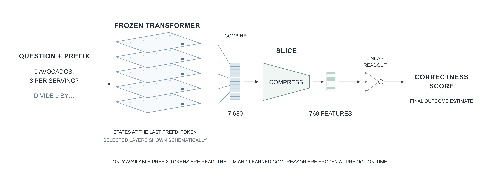
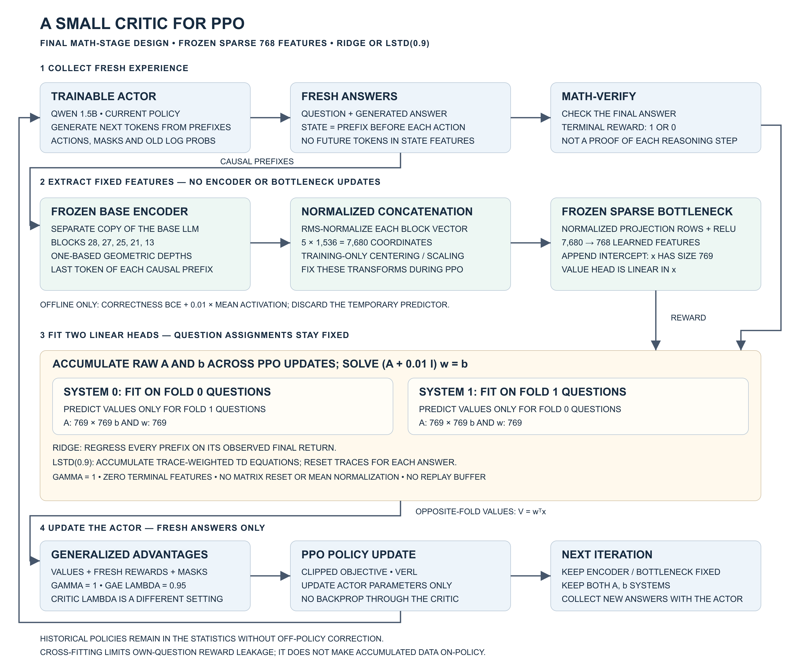

# SLICE: a compact critic for PPO

**A language model writes an answer. A small critic estimates whether it will
finish correctly. PPO uses that estimate to help the model learn.**

Usually, PPO trains a separate neural value network as its critic. Here, we keep
a copy of the base language model frozen, compress a few of its internal
representations, and fit a linear value head by solving a small matrix system.
SLICE is the reusable package; this repository also contains the PPO/GRPO
comparison pipeline for numeric math questions.

[Setup](SETUP.MD) · [Package API](packages/slice-critic/API.md) ·
[Reproduce the study](docs/REPRODUCING.md)

## From a partial answer to a value

A model answering “9 avocados, 3 per serving” chooses one token at a time. At
“Divide 9 by…”, the critic estimates the eventual reward from continuing that
partial answer. Math-Verify gives the completed answer a reward of 1 or 0.
Generalized advantage estimation (GAE) combines these rewards with the critic's
values; PPO uses the resulting advantages to adjust the model's token choices.



SLICE reads the last available token's hidden vector at blocks **28, 27, 25, 21,
13** of Qwen2.5-Math-1.5B. It normalizes and combines five 1,536-dimensional
vectors, then compresses **7,680 coordinates to 768 features** with a learned
ReLU layer. The compressor is trained offline using correctness labels and an
activation penalty. “Sparse” describes that penalty and the resulting zero
activations; the implementation still uses dense operations.

The diagram's correctness score is an outcome estimate, not a proof of the
reasoning. Online Ridge/LSTD values are unbounded linear predictions; standalone
package scoring also provides a separately calibrated probability.

## The final learning algorithm

During PPO, **only the actor is updated by gradients** in the SLICE arms. Its
critic uses the frozen base encoder and frozen compressor, with fresh linear
weights fitted from accumulated statistics. Ridge fits each prefix to its
observed final reward. LSTD fits trace-weighted temporal-difference equations.

Every training question belongs permanently to one of two groups, or *folds*.
Each fold's rewards fit one head, which predicts values for the opposite fold.
This keeps a question's own current and historical rewards out of the head used
to calculate its advantages.

Here, `x = [768 compressed features; 1]` includes an intercept, so each `A` is
**769 × 769** and each `b` and `w` has 769 entries. The final Numina settings are
`gamma = 1`, `critic_lambda = 0.9`, `GAE_lambda = 0.95` and `epsilon = 0.01`.
Critic lambda and GAE lambda control different calculations.

```text
Freeze the base encoder, learned bottleneck and feature normalization.
Assign each training question to a fixed fold: 0 or 1.
Initialize A[fold] = 0 and b[fold] = 0 for both folds.

For each PPO update:
    Generate fresh answers with the current actor; score their final outcomes.
    Extract frozen features for every pre-action prefix; append intercept 1.

    For each answer:
        f = its question's fixed fold

        If using Ridge:
            For each prefix x:
                A[f] += outer(x, x)
                b[f] += x * final_reward

        If using LSTD:
            Reset eligibility trace z = 0 at the start of this answer.
            For each transition (x, reward, x_next):
                # reward is zero except at the last action.
                # At termination, x_next is all zero, including its intercept.
                z = gamma * critic_lambda * z + x
                A[f] += outer(z, x - gamma * x_next)
                b[f] += z * reward

    For each fold f:
        w[f] = solve(A[f] + epsilon * I, b[f])

    Predict each question's token values with the opposite fold's weights:
        value(x) = dot(w[1 - f], x)
    Compute GAE using these values, fresh rewards and terminal value zero.
    Update the actor with PPO on fresh answers only.

    Keep A and b for the next update; do not divide them by the sample count.
    Keep the encoder, bottleneck and normalization frozen.
```

The small matrix statistics persist; generated answers are not kept in a buffer.
Regularization is added when solving, including on the intercept. Past policies
remain represented in `A` and `b` without off-policy correction: question
cross-fitting limits reward leakage, but does not make old experience on-policy.



[Open the scalable architecture diagram](docs/figures/final-architecture.svg).

## Recorded Numina results

The original comparison and the completed production replay each used five actor seeds, six methods,
**120 updates × 64 answers per run**, 2,000 test questions,
fixed greedy evaluation and a 2,048-token response cap. Gamma is 1; GAE lambda is
0.95; online LSTD lambda is 0.9; cumulative regularization is 0.01. Each run uses
two A5000 GPUs. Offline feature learning and PPO validation calibration are
additional costs.

| Method | Original accuracy | Production replay accuracy | Replay training GPU hours, mean |
|---|---:|---:|---:|
| Sparse-768 Ridge PPO | **74.60%** | **74.22%** | **10.39** |
| Two-thirds-layer Ridge PPO | 72.54% | 72.61% | 9.77 |
| GRPO | 72.75% | 72.42% | 8.68 |
| Two-thirds-layer LSTD(0.9) PPO | 72.40% | 72.40% | 9.77 |
| Sparse-768 LSTD(0.9) PPO | 70.86% | 72.10% | 10.24 |
| Conventional PPO | 73.52% | 69.93% | 12.17 |

**The main result held up:** sparse Ridge had the highest mean accuracy in both
runs. In the replay it improved from the base model's **66.70% to 74.22%**, and
beat two-thirds Ridge in all five seeds: **+1.61 percentage points**, adjusted
interval **[0.17, 3.19] pp**. The original gain was +2.06 pp, interval
[0.59, 3.53] pp.

Against GRPO, the replay gain was **+1.80 pp**, adjusted interval
**[-0.16, 3.80] pp**. The original gain was +1.85 pp with an interval above zero;
the replay does not establish superiority after adjustment. Against conventional
PPO, the replay gain was **+4.29 pp**, interval **[-2.28, 12.60] pp**: also
inconclusive. PPO varied from **61.95% to 75.80%** across replay seeds, despite
passing all critic health checks. These checks test training-target fitting and
functional behavior, not held-out value accuracy or policy improvement.

Sparse Ridge used about **15% less online training compute** than conventional
PPO in the replay (about 17% in the original). It cost more than GRPO. These costs
exclude offline generation, feature extraction and compressor learning; historical
PPO calibration cost another **19.59 GPU hours** and was reused for the replay.

These are approximate seed/question bootstrap intervals with Bonferroni nominal
coverage for eight primary comparisons. Five actor seeds share one selected
compressor. Eligibility uses numeric-template separation, not semantic or
pretraining decontamination. Verifier labels need audit. All replay PPO health
checks passed; one original PPO seed failed the training-target-MSE improvement
gate while passing its other functional checks. No seeds are discarded.

The replay reused the same questions, actor seed IDs, frozen compressor and PPO
profile, with fresh actors and empty online statistics. It validates the cleaned-up
workflow and the main empirical pattern, not identical numerical outputs or an
independent benchmark. Conventional PPO's mean accuracy was not closely reproduced.

[Original results](docs/results/numina-six-method.json) ·
[Production replay and per-seed data](docs/results/numina-prod-replay.json).
Compression worked well here; sparsity itself has not been shown to speed up the
implementation. Ridge is our practical default. LSTD remains a supported
alternative, not an established winner for long horizons.

## What lives where

| Location | Responsibility |
|---|---|
| `packages/slice-critic/` | Frozen features, compressor training, Ridge/LSTD, verification, artifacts and scoring; independent of VERL. |
| `src/math_rl/` | Numina preparation, PPO/GRPO, GAE integration, validation and reporting. |
| `scripts/` | Thin commands, environment setup, Slurm submission and smoke checks. |
| `configs/` | The two active VERL configuration files. |
| `tests/` | Tests for the supported production workflow; package tests live with the package. |

The package remains **internal**, installed from source or a checked wheel; there
is no hosted API, registry or PyPI publication. Completed v1 artifacts remain
supported. The cleaned-up version passed installed-wheel CPU acceptance on Duke,
real Ridge/LSTD PPO integration checks, and the full **30-run production replay**
with successful report generation. This validates the tested workflow; it does
not guarantee fault-free behavior for every dataset or configuration.

## Reproduce or start fresh

The [reproduction guide](docs/REPRODUCING.md) provides two routes: train fresh
actors from the final locked data/filter/profile, or build a new SLICE artifact
and family-disjoint Numina study from pinned data. Retraining the representation
is a new experiment; it is not a promise to recover identical percentages.
Older exploratory code is available in Git history, not in the active workflow.
Saved outputs, model weights and environments are never deleted by setup.

The first stage established a working, lower-cost linear-critic path for PPO on
this task. Value-guided Lean search is a future application, not an implemented
or validated capability of this repository.
