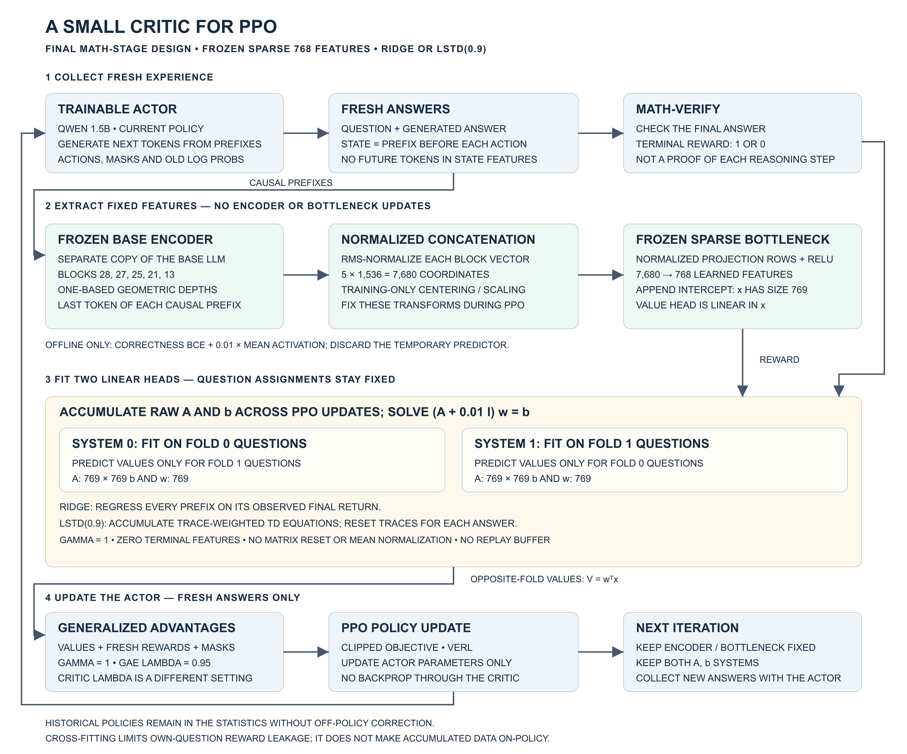
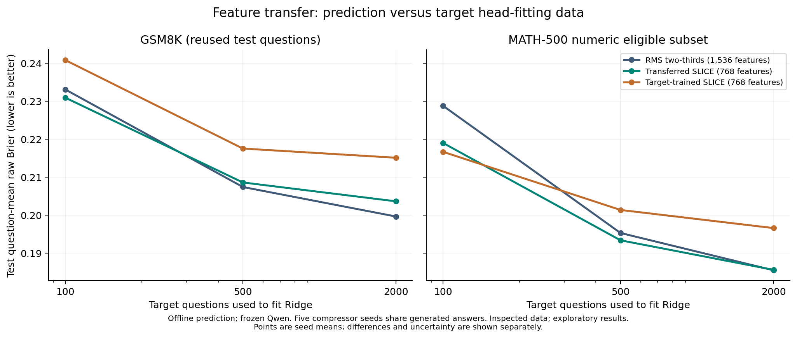
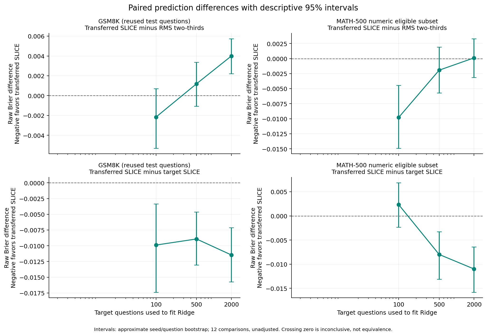

# SLICE: a compact critic for PPO

**A language model writes an answer. A small critic estimates whether it will
finish correctly. PPO uses that estimate to help the model learn.**

**Latest result:** frozen SLICE + cumulative Ridge reached **73.97%** answer
accuracy versus **72.65%** for conventional PPO, using **17.3% less online training
compute**. The adjusted accuracy interval versus PPO spans zero. Nonlinear
SLICE + MLP baselines did not improve the mean over Ridge.

**Our aim: a cheaper critic with a stable feature basis.** LLM PPO often trains
a separate transformer critic alongside the actor, adding backpropagation cost
and another large optimization problem. SLICE keeps a copy of the base model and
a learned compressor frozen, then fits a linear value head with regularized
matrix solves. The actor changes; the critic's feature coordinates stay fixed,
so its statistics can accumulate consistently across updates.

This removes critic-transformer backpropagation, not the cost of its frozen
forward pass. It simplifies critic fitting rather than proving that PPO is
mathematically unstable or that SLICE eliminates training instability. Our
experiment supports useful, lower-cost learning relative to the tested
transformer-critic baseline; a general stability advantage remains unproven.

SLICE is the reusable package; this repository also contains the PPO/GRPO
comparison pipeline and offline feature-transfer studies for numeric math questions.
Our transfer results support trying a source-trained SLICE when target head-fitting
data are limited, with a full-width single-layer readout as a strong alternative
when more target data are available.

[Setup](SETUP.MD) · [Package API](packages/slice-critic/API.md) ·
[Reproduce the study](docs/REPRODUCING.md)

## From a partial answer to a value

A model answering “9 avocados, 3 per serving” chooses one token at a time. At
“Divide 9 by…”, the critic estimates the eventual reward from continuing that
partial answer. Math-Verify gives the completed answer a reward of 1 or 0.
Generalized advantage estimation (GAE) combines these rewards with the critic's
values; PPO uses the resulting advantages to adjust the model's token choices.


SLICE reads the last available token's hidden vector at blocks **28, 27, 25, 21,
13** of Qwen2.5-Math-1.5B. It normalizes and combines five 1,536-dimensional
vectors, then compresses **7,680 coordinates to 768 features** with a learned
ReLU layer. The compressor is trained offline using correctness labels and an
activation penalty. “Sparse” describes that penalty and the resulting zero
activations; the implementation still uses dense operations.

The diagram's correctness score is an outcome estimate, not a proof of the
reasoning. Online Ridge/LSTD values are unbounded linear predictions; standalone
package scoring also provides a separately calibrated probability.

## Current v2 algorithm: one shared critic

During PPO, **only the actor is updated by gradients** in the linear SLICE arms. Its
critic uses the frozen base encoder and frozen compressor, with fresh linear
weights fitted from accumulated statistics. Ridge fits each prefix to its
observed final reward. LSTD fits trace-weighted temporal-difference equations.

Every training question uses the **same** matrix system and value head.
There is no question assignment or opposite-head prediction. After each batch,
we add all answers to the accumulated statistics, solve once, and predict that
batch's token values with the resulting weights.

Here, `x = [768 compressed features; 1]` includes an intercept, so `A` is
**769 × 769** and `b` and `w` each have 769 entries. The latest Numina settings are
`gamma = 1`, `critic_lambda = 0.05 or 0.99` (LSTD only), `GAE_lambda = 0.95`
and `epsilon = 0.01`.
Critic lambda and GAE lambda control different calculations.

```text
Freeze the base encoder, learned bottleneck and feature normalization.
Initialize one A = 0 and one b = 0 for all questions.

For each PPO update:
    Generate fresh answers with the current actor; score their final outcomes.
    Extract frozen features for every pre-action prefix; append intercept 1.

    For each answer:
        If using Ridge:
            For each prefix x:
                A += outer(x, x)
                b += x * final_reward

        If using LSTD:
            Reset eligibility trace z = 0 at the start of this answer.
            For each transition (x, reward, x_next):
                # reward is zero except at the last action.
                # At termination, x_next is all zero, including its intercept.
                z = gamma * critic_lambda * z + x
                A += outer(z, x - gamma * x_next)
                b += z * reward

    w = solve(A + epsilon * I, b)
    Predict every current prefix's value: value(x) = dot(w, x)
    Compute GAE using these values, fresh rewards and terminal value zero.
    Update the actor with PPO on fresh answers only.

    Keep A and b for the next update; do not divide them by the sample count.
    Keep the encoder, bottleneck and normalization frozen.
```

The small matrix statistics persist; generated answers are not kept in a buffer.
Regularization is added when solving, including on the intercept. Past policies
remain represented in `A` and `b` without off-policy correction. Values are
fitted on current as well as historical answers; their fitting error is not a
held-out value-quality measurement.



[Open the scalable architecture diagram](docs/figures/final-architecture.svg).

## One-head results: latest seven-method comparison

All **21 training runs and report generation completed successfully**. Seven
methods used three fresh actor seeds (**501–503**), **120 updates × 64 answers/run**
(7,680 answers), **2,000 test questions**, greedy final evaluation, a **2,048-token
response cap**, and **two A5000 GPUs/run**. All actors start from base Qwen;
base answer accuracy on this task is **66.70%**. Gamma is **1**, GAE lambda is
**0.95**, and cumulative Ridge/LSTD epsilon is **0.01**. LSTD trace lambda is a
separate setting, tested at **0.05** and **0.99**. All linear arms use one shared
matrix system; there is no buffer.

| Method | Final answer accuracy, mean ± seed SD | Training GPUh/run, mean |
|---|---:|---:|
| **Frozen SLICE + cumulative Ridge** | **73.97% ± 0.45 pp** | **10.37** |
| Frozen SLICE + cumulative LSTD(0.99) | 73.62% ± 0.72 pp | 10.61 |
| Trainable SLICE + MLP | 72.75% ± 1.18 pp | 10.68 |
| Conventional transformer-critic PPO | 72.65% ± 1.28 pp | 12.53 |
| Frozen SLICE + MLP | 72.23% ± 0.54 pp | 10.42 |
| GRPO (no critic) | 70.73% ± 1.54 pp | 8.77 |
| Frozen SLICE + cumulative LSTD(0.05) | 70.22% ± 3.20 pp | 10.11 |

These are **actor answer accuracies**, not critic prediction accuracies. SD measures
variability across three training seeds; it is not a confidence interval.

### SLICE + MLP as a nonlinear baseline

The MLP is `768 → 256 → ReLU → 1 → sigmoid`. All SLICE arms start from the same
offline compressor; neural heads start fresh. The frozen MLP updates only its
head, while the joint MLP updates the compressor and head with the encoder and
saved normalization fixed. Neither neural arm accumulates matrices.

The nonlinear baselines test whether extra trainable capacity improves policy
learning. **Ridge achieved a higher mean than both MLP variants**, showing that a
linear readout of learned nonlinear features is a capable practical critic.
This does not establish that linear functions are universally better.

An important distinction: neural values are predicted before fitting, GAE produces
detached return targets, and the MLP fits those fresh targets for two epochs.
Ridge/LSTD accumulate historical statistics and fit before GAE. Sigmoid bounds
MLP values; Ridge/LSTD values remain unbounded. This is a comparison of complete
critic recipes, not an architecture-only ablation. Neural prediction/fitting runs
on one owning actor-worker GPU; feature transport and RPC overhead are included
in training time. [Full protocol](docs/ONLINE_CRITICS.md).

### Paired comparisons

Positive differences favor the first method. Units are **percentage points of
answer accuracy**. Intervals use an approximate paired seed/question bootstrap
with 4,000 draws; adjusted intervals use Bonferroni nominal coverage across seven
planned contrasts.

| First method minus second | Mean difference | Descriptive 95% interval | Adjusted interval |
|---|---:|---:|---:|
| Frozen MLP − Ridge | −1.73 | [−3.00, −0.50] | [−3.5953, −0.0047] |
| Joint MLP − Ridge | −1.22 | [−3.22, +0.68] | [−4.20, +1.55] |
| LSTD(0.05) − Ridge | −3.75 | [−7.05, −1.02] | [−8.44, −0.35] |
| LSTD(0.99) − Ridge | −0.35 | [−1.58, +0.82] | [−2.20, +1.30] |
| Joint MLP − frozen MLP | +0.52 | [−1.50, +2.43] | [−2.20, +3.14] |
| Ridge − conventional PPO | +1.32 | [−0.30, +3.05] | [−0.99, +3.82] |
| Ridge − GRPO | +3.23 | [+1.15, +5.65] | [+0.40, +6.64] |

The frozen MLP trails Ridge in all three seeds; its adjusted interval only narrowly
excludes zero, so that endpoint is not a sharp scientific threshold. Joint training
does not establish an advantage over Ridge or the frozen MLP. LSTD(0.99) is
competitive but not proven equivalent to Ridge; LSTD(0.05) is worse here. Ridge's
gain over GRPO remains positive after adjustment; its gain over PPO is inconclusive.

Ridge used **17.3% less online training compute than PPO**, but **18.3% more than
GRPO**. Costs include training-time feature extraction/transport, fitting,
validation and checkpointing. They exclude setup, test evaluation, offline
feature learning and historical PPO calibration, so they are not total development
costs.

<details>
<summary>All latest per-seed answer accuracies (%)</summary>

| Method | Seed 501 | Seed 502 | Seed 503 |
|---|---:|---:|---:|
| Ridge | 73.55 | 73.90 | 74.45 |
| Frozen MLP | 71.85 | 72.00 | 72.85 |
| Joint MLP | 73.75 | 73.05 | 71.45 |
| LSTD(0.05) | 66.55 | 72.45 | 71.65 |
| LSTD(0.99) | 72.80 | 73.90 | 74.15 |
| Conventional PPO | 72.60 | 71.40 | 73.95 |
| GRPO | 71.25 | 71.95 | 69.00 |

</details>

[Recorded latest results and exact intervals](docs/results/numina-seven-critics-gpu.json).
This file transcribes the supplied cluster report, not an independent audit of
predictions. Successful report generation checks paired test IDs/references,
equal budgets and method-specific functional invariants; verifier answers still
need review.

## Earlier one-head study: representation controls

The earlier study used seeds **301–305**, the same 120 × 64 budget and 2,000 test
questions, with LSTD lambda **0.9**. The supplied snapshot contains all five seeds
for linear methods and GRPO but only four conventional-PPO seeds. Keep these
results separate from the latest study; do not pool the means.

| Method | Answer accuracy, mean | Available seeds |
|---|---:|---:|
| SLICE + Ridge | **75.16%** | 5/5 |
| Raw two-thirds layer + Ridge | 72.84% | 5/5 |
| Raw two-thirds layer + LSTD(0.9) | 72.36% | 5/5 |
| GRPO | 72.26% | 5/5 |
| SLICE + LSTD(0.9) | 72.16% | 5/5 |
| Conventional PPO | 72.66% | **4/5; partial** |

SLICE + Ridge exceeded raw two-thirds Ridge by **2.32 pp** in this snapshot.
No final adjusted intervals were supplied for that comparison, and the partial
PPO mean is not a completed five-seed comparison.
[Per-seed snapshot](docs/results/numina-no-folds-preview.json) ·
[One-head protocol](docs/NO_FOLDS.md).

## Feature transfer: reuse SLICE when target labels are scarce

**We demonstrated useful feature transfer within math:** a SLICE trained on
Numina can stay frozen while a new Ridge head learns to predict correctness on
GSM8K or MATH. Think of SLICE as a learned measuring instrument; refitting Ridge
teaches us how to interpret its readings in the new dataset. This transfers a
representation, not a guarantee that the original value head stays calibrated.

Our follow-up compares three representations: **Numina-trained SLICE (768
features)**, **target-trained SLICE (768)**, and **RMS-normalized Qwen block 19
(1,536)**. Qwen stays frozen in every arm. The layer control transfers no
Numina-trained component; its Ridge head is fitted directly on target data.

Five compressor seeds (42–46) share generated answers. Each head uses the same
nested **100/500/2,000 target-question subsets** and saved sampled pre-action
prefixes. Representation-training/validation question counts are matched between
source and target SLICEs and recorded in the locked fits. The target-trained
SLICE uses its larger fixed representation-training budget even when its head
uses only 100 questions: these are **head-adaptation curves**, not equal-total-label
comparisons with that arm.

All Ridge arms use training-only centering/scaling. Epsilon is selected on
validation from **0.01, 1, 10, 100, 1,000, 10,000**, with automatic expansion if the
ceiling wins. Nearly all fits selected **1,000**, inside the grid. This is an
offline setting; it does not change online cumulative PPO's epsilon of 0.01.
Models were locked before explicitly submitting test evaluation.

| Target evaluation | Ridge-training questions | RMS two-thirds Brier ↓ | Transferred SLICE Brier ↓ | Target-trained SLICE Brier ↓ |
|---|---:|---:|---:|---:|
| GSM8K | 100 | 0.23311 | **0.23094** | 0.24083 |
| GSM8K | 500 | **0.20744** | 0.20863 | 0.21756 |
| GSM8K | 2,000 | **0.19968** | 0.20367 | 0.21514 |
| MATH-500 numeric eligible subset | 100 | 0.22884 | 0.21905 | **0.21671** |
| MATH-500 numeric eligible subset | 500 | 0.19534 | **0.19342** | 0.20140 |
| MATH-500 numeric eligible subset | 2,000 | **0.18553** | 0.18564 | 0.19663 |

These are **test equal-question raw Brier scores**, averaged across five seeds;
bold marks the lowest mean, not a conclusive difference. Lower is better. They
are prediction errors, not Qwen answer accuracies.



**What the uncertainty supports:** on MATH with 100 head-training questions,
transferred SLICE improves over RMS two-thirds by **0.00979 Brier**, descriptive
95% interval **[0.00445, 0.01490]** for that improvement. At 2,000 GSM8K questions,
RMS two-thirds is better by **0.00400**, interval **[0.00223, 0.00573]**. The other
four transferred-SLICE-versus-layer intervals include zero, including the almost
identical 2,000-question MATH means. That is inconclusive, not equivalence.
Transferred SLICE also beats target-trained SLICE in five of the six comparisons
with descriptive intervals favoring transfer; the 100-question MATH comparison
is inconclusive.

<details>
<summary>Paired differences and descriptive confidence intervals</summary>



</details>

**Our working design guide:** when target head-fitting data are scarce, try a
frozen source-trained SLICE and refit Ridge. Its compact features can provide a
useful prior for a new task. With abundant target data, keep a full-width
single-layer readout as a strong alternative: it won on GSM8K at 2,000 questions
and had essentially the same mean on MATH. The crossover is task-dependent;
this study does not establish a universal 100/500/2,000-question threshold.
Here “full-width” means one 1,536-coordinate layer, not concatenating every layer.
SLICE halves the feature width and uses a 769×769 head system versus 1537×1537,
but extra compressor work and prior source training still cost compute. This
experiment does not isolate sparsity as the cause of any benefit.

The earlier transfer study also tested an unchanged Numina critic, pooled SLICE
and combined specialist SLICEs. Refitting the head helped, while the tested
ensemble did not improve prediction; the present study focuses on the three
simpler alternatives. These offline results do not establish transferred-PPO gains.

GSM8K caches were reused; only new MATH answers were generated, under the shared
1,024-token cap. MATH train supplies training/validation; MATH-500 is evaluation
only, with unsupported references excluded. Source fitting excludes MATH
train/test question-template overlaps. The numeric subset, historically inspected
benchmarks, retained-answer conditioning, shared generations and **12 exploratory,
unadjusted intervals** limit generalization. This is evidence of transfer in this
setup, not proof across arbitrary domains.

[Protocol and commands](docs/TRANSFER_CLARIFICATION.md) ·
[Recorded report and exact intervals](docs/results/transfer-clarify-report.json) ·
[PDF learning curves](docs/figures/transfer-clarify/learning-curves.pdf).
The repository plots transcribe the supplied report (means rounded to six
decimals); the cluster summary also contains fixed-epsilon diagnostics and coverage.

## Offline MLP checks: prediction is not policy improvement

These experiments predict eventual correctness from saved prefixes. They reuse
inspected Numina questions and the selected compressor. The tuned test contains
**125,920 prefixes from 2,000 questions**; recipes were selected on validation
before a separately invoked locked test evaluation. Three head-training seeds
share the same starting compressor.

| Predictor | Test Brier ↓ | Correctness-prediction accuracy |
|---|---:|---:|
| SLICE + raw Ridge | 0.183459 | 73.16% |
| SLICE + Ridge, clipped to [0,1] for offline scoring | 0.181007 | 73.16% |
| Frozen SLICE + MLP, initial recipe | 0.181589 | 73.19% |
| Joint SLICE + MLP, initial recipe | 0.183017 | 73.01% |
| Frozen SLICE + MLP, tuned recipe | 0.181095 | 73.27% |
| Joint SLICE + MLP, tuned recipe | **0.180671** | **73.33%** |

For binary labels, clipping to [0,1] cannot increase squared error. This is an
additional offline comparator, **not a change to Ridge fitting or online values**.
About 8.52% of raw Ridge predictions fell outside [0,1].

The tuned joint MLP's equal-question Brier difference versus clipped Ridge was
**−0.000306**, exploratory 95% interval **[−0.001019, +0.000453]**; the frozen MLP's
was **+0.000125**, interval **[−0.000545, +0.000791]**. These are unadjusted
seed/question intervals, including the tuning pilot seed. The small offline mean
improvement did not establish better prediction than bounded Ridge, and did not
translate into better PPO under the tested online recipes. Offline correctness
labels and online GAE-return fitting are different objectives.

[Initial offline benchmark](docs/OFFLINE_MLP.md) · [Validation tuning](docs/MLP_TUNING.md).

## Feature normalization: current design and checks

Our working PPO design is **frozen sparse-768 SLICE + Ridge, one shared head,
without output LayerNorm**. Its feature pipeline is:

```text
Five block vectors → per-vector RMS normalization → concatenate (7,680)
    → subtract the offline training mean of each coordinate
    → divide by one shared training-derived scalar
    → row-normalized learned projection + bias + ReLU (768)
    → append intercept 1 → linear value head
```

RMS normalization has no learned gain. Centering/scaling statistics are fitted
offline and frozen during PPO; the scalar scale is not per-coordinate
standardization or whitening. Projection-row normalization controls weight norms,
not output norms. No normalization is added after ReLU. The existing raw
two-thirds online control has no additional feature normalization.

We tested three frozen representations with newly fitted **offline Ridge** heads
on matched sampled prefixes from the saved Numina data (2,000 test questions):

| Representation | Test raw Brier ↓ | Correctness-prediction accuracy ↑ | Condition number of regularized system |
|---|---:|---:|---:|
| RMS-normalized two-thirds | 0.18957 | 71.8% | 481,000 |
| SLICE + output LayerNorm | **0.18302** | 73.2% | 831,000 |
| Unchanged SLICE | 0.18345 | 73.2% | **30,000** |

These rows use the predeclared penalty
`epsilon = max(0.01, 0.0001 * trace(A_train) / design_width)` (about 63, 63 and
57.9 respectively). LayerNorm was applied **after the existing frozen ReLU
features**, per prefix, without learned affine parameters; its internal epsilon
was `1e-5`. We did not retrain the compressor with LayerNorm present.

LayerNorm slightly reduced equal-question Brier error versus unchanged SLICE:
**−0.000405**, descriptive 95% interval **[−0.000714, −0.000106]**. Accuracy was
unchanged at the displayed precision. Sweeping **Ridge** epsilon through 0.01,
0.1, 1, 10 and 100 barely changed predictions. For LayerNorm it reduced the
condition number from **5.23 billion to 523,000**: zero-mean feature vectors have
a redundant direction, so a large condition number need not imply poor predictions.

**Decision:** retain unchanged SLICE + Ridge for PPO. Output LayerNorm remains a
small offline improvement, not a demonstrated RL improvement. We have not tested
LayerNorm with LSTD or PPO, joint compressor training with LayerNorm, or whitening.
This ablation lacks a matched raw two-thirds arm, so it does not establish whether
RMS normalization itself helped that layer. Questions and verifier labels were
reused; intervals are exploratory and unadjusted, not independent replications
across epsilon settings. [Protocol and commands](docs/OFFLINE_NORMALIZATION.md) ·
[Recorded normalization report](docs/results/ridge-normalization-epsilon.txt).

## Discussion: LSTD and numerical conditioning

LSTD learns through relationships between successive states. Its trace lambda
controls how earlier features contribute to the TD equations; GAE lambda controls
the separate advantage calculation. With gamma 1, direct trace contributions decay
as `critic_lambda^distance`. This is not a hard credit-assignment cutoff: the
joint TD solve can also propagate values.

For complete episodes, gamma 1, zero terminal features and lambda **exactly 1**,
the raw LSTD matrices equal Ridge's Monte Carlo regression matrices on the same
trajectories. High lambda moves LSTD toward full-return regression; 0.99 remains
different from 1. The latest result supports keeping LSTD(0.99) as a competitive
alternative, not claiming equivalence or a universal advantage on long horizons.
Low lambda can trade sampling variance for bootstrapping/approximation error.

For the solved system `M = A + epsilon I`, the 2-norm condition number is
`kappa(M) = largest singular value / smallest singular value`. It measures
worst-case sensitivity, not prediction quality. Ridge's matrix is symmetric;
LSTD's generally is not, so singular values give a common diagnostic.
Across five final checkpoints of the earlier one-head study (epsilon 0.01):

| Features | Ridge condition number | LSTD(0.9) condition number |
|---|---:|---:|
| SLICE sparse-768 | 30,200–31,100 | 2,700–2,950 |
| Raw two-thirds | 6.51–6.67 million | 0.752–0.778 million |

LSTD was better conditioned yet produced worse mean actor accuracy. Final
conditioning alone therefore does not explain its performance gap. These are
older LSTD(0.9) final-checkpoint diagnostics, not measurements throughout training
or of the latest 0.05/0.99 runs. Our features predict correctness but need not
preserve all transition dynamics; changing-policy accumulation is another possible
source of approximation error. These are hypotheses, not established causes.

## What lives where

| Location | Responsibility |
|---|---|
| `packages/slice-critic/` | Frozen features, compressor training, Ridge/LSTD, verification, artifacts and scoring; independent of VERL. |
| `src/math_rl/` | Numina preparation, PPO/GRPO, linear and neural critics, GAE and reporting. |
| `tools/diagnostics/` | Offline ablations and the seven-method GPU comparison. |
| `tools/transfer/` | Dataset transfer, regularization learning curves, checks and plots. |
| `scripts/` | Thin commands, environment setup, Slurm submission and smoke checks. |
| `configs/` | The two active VERL configuration files. |
| `tests/` | Tests for the supported production workflow; package tests live with the package. |

The package remains **internal**, installed from source or a checked wheel; there
is no hosted API, registry or PyPI publication. Completed v1 artifacts remain
supported. The one-head workflow has passed installed-wheel CPU acceptance and
real GPU integration checks. All seven methods in the latest 21-run study completed real
actor training and report generation. This validates the tested workflow, not
every dataset or configuration.

## Reproduce or start fresh

Repeat the latest comparison using [the seven-method protocol](docs/ONLINE_CRITICS.md)
with a new output directory. For a fresh SLICE artifact or the data/filter/actor
pipeline, use [the reproduction guide](docs/REPRODUCING.md). Retraining features
is a new experiment, not a promise to reproduce identical percentages. Saved
outputs, model weights and environments are not removed by setup.

The latest comparison uses fresh actor seeds on reused inspected questions and
one selected compressor. PPO calibration is reused. Numeric-template separation
is not semantic or pretraining decontamination; three seeds and approximate
bootstrap intervals limit inference. No functional check substitutes for a
verifier audit.

**Current decision:** keep frozen sparse-768 SLICE + cumulative Ridge as the
practical default, LSTD(0.99) as a competitive alternative, and MLPs as nonlinear
baselines. Offline feature transfer within math is now demonstrated in the tested
setting; choose compact or full-width features using target-data availability and
validation. Transferred PPO and value-guided Lean search remain future studies.
