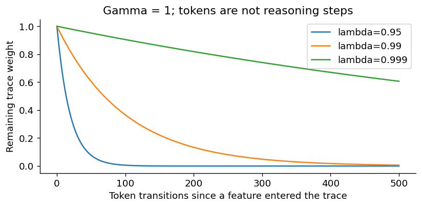

# A critic built from accumulated matrices

*Part 2 of Building a Cheaper Critic · 13 October 2026*

Imagine keeping a notebook of every answer a language model has attempted. Each page records the answer's intermediate states and whether it eventually succeeded. To improve a critic, we could repeatedly reread those pages and run gradient descent.

For a particular kind of critic, there is another option: summarize the pages into a matrix and a vector. New experience adds to those summaries. A linear solve produces new weights.

That is the attraction of least-squares temporal-difference learning, or LSTD. The matrix accumulation is established machinery, not our invention. The central idea applies whenever an agent needs to predict future reward from a fixed set of features.

## 1. What does “linear” really restrict?

Consider a language model answering “What is five plus four?” Its state is the question and the answer written so far. A fixed encoder maps that text to a vector \(\phi(s)\). The value is the expected reward if the policy continues from that state. A robot could use sensor features instead; the mathematics below would be the same.

The critic predicts:

\[
\widehat V(s)=w^\top\phi(s).
\]

The feature map can be highly nonlinear in the text. Only the fitted head is linear. An intercept can be included by appending a constant one to each nonterminal feature vector.

This matters computationally. Fitting \(w\) need not backpropagate through the encoder. But it also matters statistically: if success depends on a relationship the chosen features do not expose to a linear head, solving the weights more accurately cannot manufacture it.

## 2. First understand the simpler alternative: ridge

Suppose an answer receives final return \(R\). With gamma one and terminal-only reward, every earlier state in that episode has observed return \(R\). Ridge regression minimizes:

\[
\sum_t(w^\top\phi_t-R_t)^2+\epsilon\lVert w\rVert^2.
\]

Its sufficient statistics are:

\[
G=\sum_t\phi_t\phi_t^\top,\qquad c=\sum_t\phi_tR_t,
\qquad (G+\epsilon I)w=c.
\]

Every update adds another outer product to \(G\), and another feature-weighted return to \(c\). The matrix measures which feature coordinates occur together. The vector measures how they occur alongside success.

This is direct outcome regression. LSTD asks for a different kind of consistency.

## 3. Derive LSTD from the TD update

For linear TD(0), an update is proportional to:

\[
\phi_t\delta_t
=\phi_t\left[r_t+\gamma w^\top\phi_{t+1}-w^\top\phi_t\right].
\]

At an empirical fixed point, the sum of those updates is zero. Rearranging gives:

\[
\underbrace{\sum_t\phi_t(\phi_t-\gamma\phi_{t+1})^\top}_{A}w
=\underbrace{\sum_t\phi_t r_t}_{b}.
\]

This derivation explains a commonly missed point: LSTD does not simply regress onto a permanently fixed list of next-state targets. It solves the consistency equations implied by the TD updates. Unlike ridge's Gram matrix, \(A\) need not be symmetric.

We solve \((A+\epsilon I)w=b\) numerically rather than explicitly computing an inverse. A small residual confirms that the equations were solved accurately. It does not confirm that the resulting values generalize.

The foundations are [Bradtke and Barto's LSTD paper](https://people.eecs.berkeley.edu/~pabbeel/cs287-fa09/readings/BradtkeBarto-lstd-1996). [Lagoudakis and Parr's LSPI paper](https://jmlr.org/papers/v4/lagoudakis03a.html) extends least-squares policy evaluation into a control algorithm. LSTD can also supply a value critic to a separate policy optimizer such as PPO; using it does not require adopting LSPI.

## 4. Watch one successful episode enter the matrix

Take two pre-action states with features
\(\phi_0=(1,0)^\top\) and \(\phi_1=(1,1)^\top\).
Rewards are zero and then one. The terminal next feature is \(\phi_2=(0,0)^\top\), including its intercept. Let gamma equal one.

For LSTD(0), the first transition contributes:

\[
\phi_0(\phi_0-\phi_1)^\top
=\begin{bmatrix}0&-1\\0&0\end{bmatrix}.
\]

The final transition contributes:

\[
\phi_1\phi_1^\top
=\begin{bmatrix}1&1\\1&1\end{bmatrix}.
\]

Thus:

\[
A=\begin{bmatrix}1&0\\1&1\end{bmatrix},
\quad b=\begin{bmatrix}1\\1\end{bmatrix},
\quad w=\begin{bmatrix}1\\0\end{bmatrix}
\]

without regularization. Both observed states receive value one. That fits this one successful episode perfectly; it does not establish a real success probability of one. We need failures, variation and held-out evaluation to learn more than this episode.

## 5. Let past states share in later evidence

LSTD(lambda) replaces the left-hand feature in each update with an eligibility trace:

\[
z_t=\gamma\lambda z_{t-1}+\phi_t,
\qquad
A\mathrel{+}=z_t(\phi_t-\gamma\phi_{t+1})^\top,
\qquad b\mathrel{+}=z_t r_t.
\]

The trace remembers earlier features with geometrically declining weight. It resets at the beginning of **every answer**. The matrices do not have to reset.

For our two-state example at lambda 0.99, \(z_0=(1,0)^\top\) and \(z_1=(1.99,1)^\top\). The accumulated system becomes:

\[
A=\begin{bmatrix}1.99&0.99\\1&1\end{bmatrix},
\qquad b=\begin{bmatrix}1.99\\1\end{bmatrix}.
\]

It again gives \(w=(1,0)^\top\). On richer data, changing lambda changes the fitted compromise.

The trace-weight plot below shows how differently 0.95 and 0.99 treat evidence a hundred tokens in the past.

Lambda is not the reward discount. Gamma sets how much future reward matters. Lambda controls how the estimation procedure combines evidence over time. With gamma one, a trace weight after 100 transitions is about 0.366 for lambda 0.99, but only 0.006 for lambda 0.95. A hundred tokens need not correspond to a hundred reasoning steps.

## 6. Why lambda one can become outcome regression

For a complete episode with gamma one, lambda one and zero terminal features, \(z_t=\sum_{i=0}^t\phi_i\). Reordering the sums makes the future differences telescope:

\[
A=\sum_i\phi_i
\left[\sum_{t=i}^{T-1}(\phi_t-\phi_{t+1})\right]^\top
=\sum_i\phi_i\phi_i^\top.
\]

Similarly, \(b=\sum_i\phi_iG_i\), where \(G_i\) is the observed undiscounted return from state \(i\). These are the Monte Carlo regression statistics. With matching state weights and regularization, the solutions match.

This gives a useful implementation check: under these assumptions, LSTD(1) and matched outcome regression should agree. Their agreement follows from algebra, not from two unrelated learning procedures happening to converge.

## 7. Accumulation needs a fixed ruler

A cumulative design preserves \(A\) and \(b\) across actor updates. New trajectories add new contributions; then we solve again. For example, use raw sums plus \(0.01I\), without dividing the statistics by their sample count. Specify whether the diagonal regularizer includes the intercept; that choice changes the fitted system.

If we rewrote the system in average form after \(n\) transitions, it would contain \(\epsilon/n\) instead. That is the sense in which a fixed diagonal regularizer becomes weaker relative to accumulating data. It does not guarantee good conditioning in every direction.

Keeping the feature map fixed is the simplest way to ensure those sums remain in the same coordinates. If feature coordinate seven changes meaning halfway through, old and new outer products no longer describe the same feature map. Centering and scaling must also remain fixed.

Refreshing the encoder while clearing the matrices is coherent, but discards accumulated information. Keeping old statistics after a refresh would require a justified transformation or recomputation.

## 8. Two complications the compact equations hide

First, the actor changes. Older trajectories were generated by older policies. A fixed encoder keeps coordinates consistent; it does **not** turn those trajectories into on-policy data for the newest actor. Without an off-policy correction, accumulation fits a mixture of historical experience. Standard fixed-policy TD guarantees do not automatically apply to that changing-policy setting.

Second, using a question's own final reward to fit the baseline for its actions can create fitting leakage. One safeguard is to assign each question permanently to one of two folds. Statistics from fold A fit the head used on B, and vice versa. Every answer to a question stays with that question. The actor still updates only on its fresh batch.

This cross-fitting does not remove all value approximation bias or historical-policy mismatch. It prevents a more immediate shortcut: putting an answer's outcome into the weights that judge the same answer.

## 9. What the solve does—and does not—buy

The unregularized equation finds the empirical zero of the linear TD updates, when a unique solution exists. In the appropriate fixed-policy setting, enough representative data connects this to the corresponding population TD fixed point. It is not a guarantee of the exact value function: the features may be insufficient. Adding regularization also changes the equation being solved.

We accumulate **statistics**, not fitted weights. If one batch gives weights \(w_1\) and another gives \(w_2\), adding those vectors does not generally give the fit to both batches. Adding their \(A\) matrices and \(b\) vectors, then solving, does give the combined empirical system with the chosen single regularizer.

These summaries are bounded in size as experience grows, but not arbitrarily cheap. With \(k\) features, dense matrix storage is quadratic and a conventional dense solve is cubic in \(k\). Increasing the feature width fivefold means approximately 25 times the matrix storage and 125 times the solve work. Collecting features and constructing the statistics also have costs.

The attraction is therefore specific: repeated experience can update a linear critic without repeatedly optimizing a large neural network. Whether that is a good trade depends on feature quality, conditioning, policy drift and total runtime.

**Further reading:** [Original LSTD](https://people.eecs.berkeley.edu/~pabbeel/cs287-fa09/readings/BradtkeBarto-lstd-1996), [LSPI](https://jmlr.org/papers/v4/lagoudakis03a.html), and [our experimental application](04-building-a-cheaper-ppo-critic.md).

Could a stable, expressive feature map make accumulated statistics more useful than repeated neural critic training—and how quickly would that advantage disappear as the policy changes?
