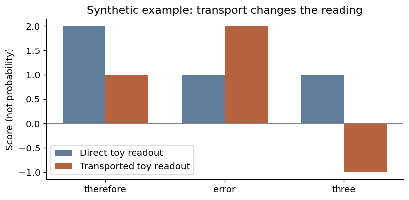

# Reading a model through J-lens

*Part 3 of Building a Cheaper Critic · 13 October 2026*

Suppose we pause a language model halfway through a math answer. We can read the words it has written. We can also read thousands of numbers inside the network. Which of those numbers would help us predict whether it will finish correctly?

This is a different question from asking what the model will say next. After “The answer is,” the next token could be highly predictable even when the answer is wrong. A useful critic needs information about eventual success, not just fluent continuation.

An interpretability tool tries to make internal representations readable. J-lens does this by relating internal directions to vocabulary directions through the computation that follows them. To understand what that buys us, it helps to build a very small version by hand.

The [J-lens 101 notebook](jlens-companion.ipynb) takes an even simpler route: train a tiny three-hidden-layer network on four country–capital pairs, then inspect it with an averaged Jacobian. It runs on a laptop, needs no model downloads, and omits critic fitting and project infrastructure. It is a teaching analogue, not a transformer or a reproduction of the paper.

## 1. A hidden vector is a state description

A transformer processes the question and answer prefix through successive blocks. At each token position, each block produces a vector. A small model might use hundreds of coordinates; larger models use thousands.

At prefix length zero, the state ends at the last prompt token. After five answer tokens, it ends at the fifth answer token. The critic reads the vector at that position, before the next action. Feeding a complete saved trajectory through a causal model can recover these vectors efficiently, provided indexing and attention masking prevent access to future tokens.

A coordinate is not ordinarily a named variable such as “arithmetic confidence.” Information can be distributed over directions involving many coordinates. A linear probe learns which combination predicts its target.

Suppose our toy hidden vector is

\[
h=\begin{bmatrix}2\\1\end{bmatrix}.
\]

Those two numbers are not yet words, probabilities or values. Their meaning depends on what later computation does with them.

## 2. Turn directions into vocabulary scores

For an illustrative vocabulary containing “therefore,” “error,” and “three,” define an unembedding matrix:

\[
U=\begin{bmatrix}1&0\\0&1\\1&-1\end{bmatrix}.
\]

Then \(Uh=(2,1,1)^\top\). Each row asks how strongly the vector points in one vocabulary direction. These are scores, not calibrated probabilities. Applying softmax would produce a distribution, but that would be an additional nonlinear transformation.

Applying the final unembedding directly to an earlier layer assumes its coordinates already have the final layer's meaning. That assumption can fail. In a toy network, a later block might swap the two coordinates. Reading the earlier vector as if no swap occurred would confuse their downstream roles.

The official Jacobian lens estimates a linear transport between internal and final representations using averaged derivatives. It then reads the transported vector through the model's output mapping. Its averaging includes current and future target positions, so a lens readout should not be interpreted as an ordinary next-token forecast. [Official J-lens documentation](https://github.com/anthropics/jacobian-lens)

## 3. What a Jacobian contributes

A derivative describes how an output changes under a small input change. A Jacobian collects those derivatives for a vector-valued function. If \(F\) maps an internal activation to a later activation, then locally:

\[
F(h+\Delta h)\approx F(h)+J(h)\Delta h.
\]

This is a local approximation, not an exact replacement for the remaining transformer. A fitted lens can use an averaged transport, rather than recomputing a complete context-specific Jacobian at every prefix.

For the toy coordinate swap,

\[
J=\begin{bmatrix}0&1\\1&0\end{bmatrix},
\qquad UJh=(1,2,-1)^\top.
\]

The scores change because the readout now accounts for the toy downstream transformation. Nothing in this calculation proves that “error” predicts an actual incorrect answer. The vocabulary labels were invented for the example. That association would need data.

## 4. Reading every vocabulary score

One complete-readout representation, used in our accompanying experiment, at layer \(\ell\) is:

\[
x_\ell=\frac{J_\ell h_\ell}
{\sqrt{\operatorname{mean}((J_\ell h_\ell)^2)+\eta}},
\qquad q_\ell=U\operatorname{diag}(g)x_\ell.
\]

Here \(g\) is the learned final RMSNorm gain and \(\eta\) is its numerical stabilizer. The final block uses identity transport. We keep pre-softmax scores; we do not select only a few words or fit the critic to a softmax distribution.

A sparse reconstruction is a different operation: it approximates a vector using a limited set of vocabulary-associated directions. A full readout instead keeps every score. A readable list of the top words is useful for inspection, but training only on that list can discard information.

Normalization matters. It changes the feature map nonlinearly and removes much of the variation in vector magnitude. That is why a normalized-hidden control is necessary: an improvement over raw features might come from normalization rather than the Jacobian transport.

## 5. Full vocabulary information without a vocabulary-sized vector

Suppose the vocabulary is much wider than the hidden vector. Materializing every score for every training prefix is expensive. But all scores have the form \(q=Bx\), where \(B=U\operatorname{diag}(g)\). They lie in a space of rank at most the hidden width.

Factor the small matrix:

\[
B^\top B=CC^\top,
\qquad \psi=C^\top x.
\]

For any two states,

\[
\psi_i^\top\psi_j=x_i^\top B^\top Bx_j=q_i^\top q_j.
\]

The compact vectors therefore preserve full-readout inner products exactly, up to numerical precision. We are not dropping low-ranked vocabulary words. For ridge with the corresponding isotropic penalty, this geometry supports equivalent linear predictions. That equivalence does not extend automatically to arbitrary neural-network training procedures.

An implementation can check this identity against full readout scores. Compact coordinates are an advanced implementation detail; the introductory notebook leaves them out so it can focus on what the lens does.

## 6. Why read several layers?

A transformer repeatedly changes its representation. Reading several layers gives a predictor access to several stages of computation. Concatenation simply places those vectors side by side. It does not establish that each contributes independent information, and it increases fitting cost and opportunities to overfit.

A fair comparison needs more than a lens-based representation and one arbitrarily chosen hidden layer. Compare the same layers with and without the lens, add a normalization-matched control, and include a strong single-layer baseline. Keep questions, prefixes, labels and fitting budgets aligned. Select settings on validation data before examining test results.

The [J-space paper](https://transformer-circuits.pub/2026/workspace/index.html) motivates studying verbalizable internal representations and their functional role. Its findings do not establish that a vocabulary readout contains every useful internal signal, or that it is automatically the best feature map for predicting reward. Interpretation and prediction ask different questions.

## 7. Why a linear transformation can help without adding information

Ignoring normalization, a linear head on \(Mh\) predicts \(w^\top Mh=(M^\top w)^\top h\). It is still linear in the original activation. An invertible change of coordinates does not enlarge the function class.

It can change the effect of regularization. A small weight in transformed coordinates may correspond to a large weight in raw coordinates. Training on finite data with a norm penalty therefore prefers different solutions. A rank-deficient transform can additionally discard directions, which may help or hurt.

This distinction is important when interpreting an experiment. A vocabulary-oriented representation can be an effective inductive bias without being a richer source of information. Conversely, a visually interpretable representation may omit a subtle numerical feature that a raw hidden probe needs.

## 8. What would count as useful evidence?

Imagine that “error” appears prominently when a model is about to fail. That is an interesting observation, but there are alternative explanations: the question itself may mention errors, or the answer may be explaining how to correct one. A readout is not a literal transcript of an inner voice.

A first test would define the readout feature in advance and ask whether it predicts failure on new questions. Compare it with the ordinary hidden vector and simple controls such as prefix length. For a value predictor, evaluate probability quality as well as classification accuracy. A second, different test would intervene on the representation and measure what changes. Correlation supports prediction; a controlled intervention can support a causal claim.

Even successful prediction would not yet show that the representation improves reinforcement learning. A critic must help assign useful advantages under a changing policy, at an acceptable total cost. The complete lens is a candidate feature map, not an answer to that question by definition.

**Try it:** [J-lens 101 notebook](jlens-companion.ipynb). **Read further:** [official implementation](https://github.com/anthropics/jacobian-lens), [original paper](https://transformer-circuits.pub/2026/workspace/index.html), and [the project experiment](04-building-a-cheaper-ppo-critic.md).

In the future, could a vocabulary-oriented view make a critic both easier to understand and better at predicting success—or are the most useful value features partly ones that resist being put into words?
