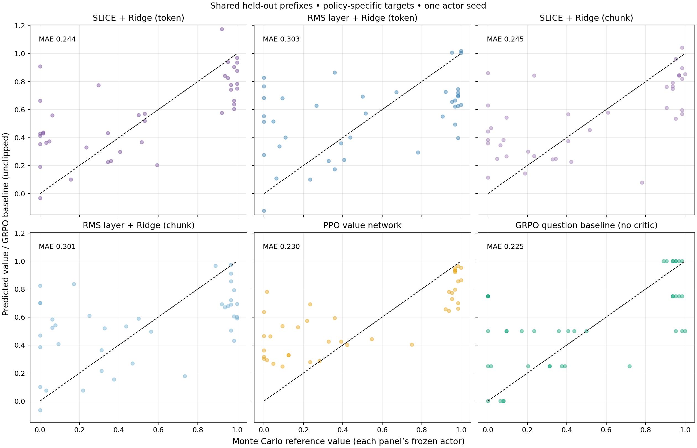
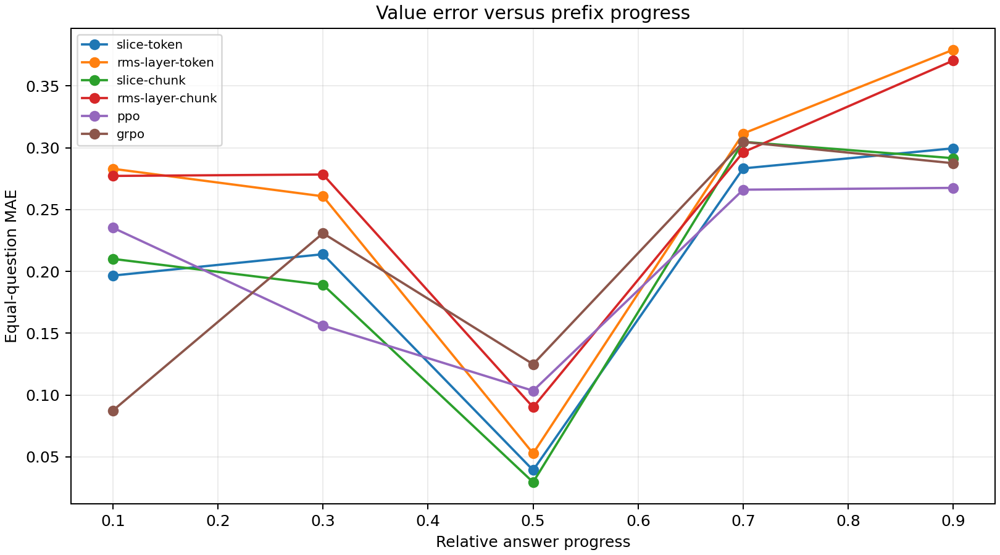

# How accurately do our critics estimate a partial answer's chance of success?

**In the completed 10-question pilot, SLICE/token and SLICE/chunk had MAE
0.244 and 0.245 versus 0.303 and 0.301 for the normalized-layer critics; PPO
had 0.230 and GRPO's baseline 0.225. Each actor defined a different reference
value function, so this was a deployment diagnostic, not an isolated ranking
of critic architectures.**

## Setup

Six fresh actors used one actor seed (1001), 120 PPO/GRPO updates × 64 answers,
the preserved Numina splits, Qwen2.5-Math-1.5B and one existing sparse compressor.
Ridge used one cumulative head, epsilon .01, frozen features and no output
LayerNorm; gamma was 1 and GAE lambda .95. Conventional PPO used the preselected
`higher_lr` critic profile. Chunk arms used MATH segmentation with 32-token
fallbacks. The layer controls were **RMS-normalized**, unlike the raw-layer
controls in the earlier token/chunk study.

After training, all actors and critics were frozen. Ten held-out test questions
provided one mixture-generated bank of **40 shared pre-chunk prefixes**. Every
critic scored that same bank, while reference continuations followed its own
actor: **64 continuations per state per actor**, totaling **15,360 reference
completions**. Independent four-answer GRPO groups and bank generation were
additional. GRPO has no value network: its question-level group mean stayed
constant across each question's prefixes.

No MC reference outcome was used for fitting, checkpoint selection or tuning.
Predictions were not clipped. Metrics weighted questions equally. Reference
standard error could reach .0625 at 64 samples; sampled zero/one values are
not proof that a state truly has probability zero/one. Cumulative heads were
fitted before the final actor update; PPO's last critic targets also came from
the final pre-update rollouts.

## Completed pilot results

| Estimator | Value MAE ↓ | Actor validation accuracy ↑ |
|---|---:|---:|
| SLICE + Ridge / token | 0.244 | 74.0% |
| RMS two-thirds + Ridge / token | 0.303 | 72.6% |
| SLICE + Ridge / chunk | 0.245 | 74.0% |
| RMS two-thirds + Ridge / chunk | 0.301 | 76.0% |
| PPO transformer critic | 0.230 | 74.0% |
| GRPO question baseline | 0.225 | 73.0% |

MAEs are the **three-decimal final plot annotations**, not the earlier partial
nine-question table. Full-precision final RMSEs and bootstrap ranges were not
supplied here and are not reconstructed from provisional results. Actor
accuracies are the saved final **validation** results, not the prior 2,000-question
test scores. One actor seed supplies no estimate of between-seed uncertainty.

## Interpretation

- SLICE's descriptive MAE was about **19% lower** than its corresponding
  normalized-layer control. Token and chunk SLICE means were almost identical.
- PPO and GRPO's baseline had lower average MAE than SLICE in this pilot. These
  results do not establish superior SLICE value accuracy or equivalence to PPO.
- Learned critics often overestimated near-zero reference values and
  underestimated near-one values. Occasional unbounded Ridge outputs were
  retained honestly; they do not by themselves imply a failed matrix solve.
- Actor accuracy and value MAE did not give the same ordering. The normalized
  layer/chunk actor reached 76% validation accuracy despite relatively high
  value error. Average final-checkpoint calibration is not a complete measure
  of the advantages or policy updates throughout training.
- Shared states did **not** mean shared targets. Continuing the same prefix
  under different actors can produce different success probabilities. This
  prevents attributing every MAE difference to feature/head quality alone.

The progress plot showed a middle-bin dip and higher late-prefix error,
especially for the normalized-layer critics. With only 40 states across five
bins, different small question subsets can drive the shape. Bin centers are
not exact measured positions; progress is a fraction of the original sampled
answer's token length, not reasoning-step index. We did not infer a reliable
middle-of-reasoning advantage from this curve.

## Relation to VinePPO and next step

This uses VinePPO's MC reference-value diagnostic idea, **not a direct
replication**. Its illustrated analysis used DeepSeekMath-7B on MATH and
256 reference continuations per state; ours used Qwen-1.5B on Numina and 64.
There was no VinePPO estimator arm: our chunk critics still used learned Ridge
values and GAE. [VinePPO, Section 7](https://arxiv.org/html/2410.01679v2#S7).

The completed pilot motivated the [fixed-policy comparison](21-fixed-policy-critics.MD):
freeze one actor, generate identical fitting answers for every learned critic,
and use **one common reference-value bank** for all panels. That follow-up has
not run yet. The larger six-actor 50-question/256-reference audit is not recorded
as completed.

## Evidence and scope

[Protocol, uncertainty and cluster commands](../docs/VALUE_AUDIT.md).
Cluster output: `outputs/numina-value-audit-v1/pilot/`; training array **13491630**,
reference/prediction array **13491634**, report job **13491635**. All listed pilot
jobs completed with exit code 0. Results and images were supplied from the
completed run in the project discussion; raw model checkpoints, continuation
caches and full `summary.json` remain on Duke. Questions and compressor were
reused from inspected studies; this is exploratory, not an independent benchmark.
