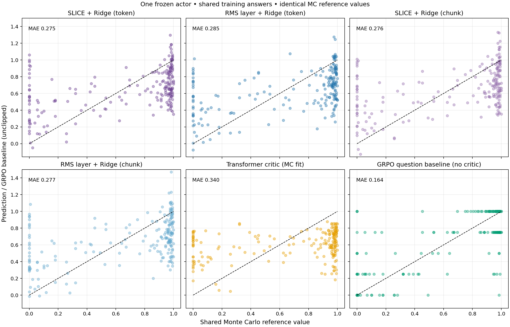
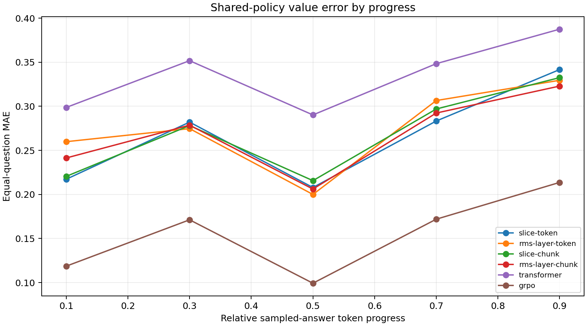

# How do critics compare when the policy, adaptation answers and reference values are shared?

**SLICE/token had the lowest learned-critic MAE, 0.27451, but the supplied paired
intervals did not establish differences between the tested Ridge variants.
The MC-trained transformer scored 0.34033 and GRPO's sampling baseline 0.16363;
the transformer was still improving at its training limit, and GRPO received
additional verified outcomes for each test question.**

## Setup: one actor and one value target

We froze the completed SLICE/token actor from the previous audit (actor seed
1001, update 120). The actor was never optimized in this experiment. Its weights,
base Qwen2.5-Math-1.5B encoder, existing sparse compressor, question selection and
runtime were pinned. This fixes the cross-policy target mismatch in
[Experiment 20](20-monte-carlo-value-audit.MD).

| Component | Budget / setting |
|---|---|
| Training | 500 questions × 4 newly generated answers = 2,000 answers |
| Validation | 100 questions × 4 newly generated answers = 400 answers |
| Evaluation | 50 held-out test questions; 200 shared prefixes |
| Reference | 128 independent continuations/prefix = 25,600 shared continuations |
| Sampling | Temperature 1, top-p 1, top-k −1; 2,048-token total response cap |
| Ridge | One raw-sum system/arm, epsilon .01, appended intercept |
| Frozen representations | SLICE 768; RMS-normalized two-thirds layer 1,536 |
| Transformer | Full base-model token critic; zero scalar head; AdamW 5e−5; at most 2 epochs |

All learned critics fitted the **same observed final returns from the same
fixed-policy answers**. Token Ridge used every pre-action prefix; chunk Ridge
used MATH chunk starts with a 32-token fallback. This intentionally leaves
fitted-state weighting different. No output LayerNorm or primary clipping was
added. The compressor retained its prior supervised training; historical
representation-learning costs and labels were not matched across arms.

The transformer optimized pooled-token squared error against those same returns.
Validation selected its epoch, including epoch zero. It used **no GAE targets,
PPO objective or actor updates**: it is an MC-trained transformer critic, not
the conventional PPO baseline from earlier online experiments.

Every estimator scored exactly the same test prefixes. Each horizontal reference
was the fraction of correct continuations under the **same frozen actor**, with
the remaining response budget preserved. References were generated once, then
reused by all six panels. They were not used to fit or select models. GRPO's
comparator used a separate four-answer prompt group per test question: **200
additional verified answers**, with one constant baseline per question.

## Results

| Estimator | Raw MAE ↓ | Raw RMSE ↓ | Predictions outside [0,1] |
|---|---:|---:|---:|
| **SLICE + Ridge / token** | **0.27451** | **0.34716** | 8.50% |
| RMS two-thirds + Ridge / token | 0.28543 | 0.35103 | 8.00% |
| SLICE + Ridge / chunk | 0.27574 | 0.35070 | 9.00% |
| RMS two-thirds + Ridge / chunk | 0.27693 | 0.34974 | 9.00% |
| MC-trained transformer | 0.34033 | 0.38910 | 0.00% |
| GRPO question baseline | 0.16363 | 0.25977 | 0.00% |

Metrics weight each question equally. MAE measures absolute error in success
probability, not actor answer accuracy. No new actor-accuracy comparison was run.

| Paired contrast: first minus second | Mean MAE difference | Question-bootstrap 95% interval |
|---|---:|---|
| SLICE/token − RMS layer/token | −0.01092 | [−0.03012, +0.00855] |
| SLICE/chunk − RMS layer/chunk | −0.00119 | [−0.02104, +0.01935] |
| SLICE/chunk − SLICE/token | +0.00123 | [−0.00698, +0.00970] |
| Transformer − SLICE/token | +0.06582 | [+0.03636, +0.09571] |
| GRPO baseline − SLICE/token | −0.11088 | [−0.17069, −0.05801] |

These are exploratory, **unadjusted** intervals conditional on sampled MC
references, with one actor and one transformer fitting seed. The three supplied
Ridge contrasts cross zero: neither superiority nor equivalence is established.
The fitted transformer and GRPO baseline differ from SLICE/token under this
conditional analysis; that is not a universal architecture or PPO ranking.

## Reading the scatter

The dashed diagonal is the **ideal y=x reference**, not a fitted regression line.
Vertical distance is prediction error. Near-zero reference states often receive
moderate/high predictions, while many near-one states receive moderate/low
predictions. These in-range mistakes show that errors are not explained solely
by unbounded linear outputs. A trend line near the diagonal would not suffice:
the individual predictions also need to cluster tightly around it.

GRPO's horizontal bands are four-answer means (0, .25, .5, .75, 1). Its lower
error demonstrates the usefulness of sampling the particular question. Learned
critics make zero-query predictions on those test questions; the information
and inference-cost budgets therefore differ. A constant prompt baseline still
cannot recognize which intermediate step helps or breaks a solution. No action
ranking or policy-improvement advantage follows from this plot alone.

MC references themselves are noisy: worst-case standard error is about .0442
at 128 continuations. Observing all successes/failures does not prove an exact
value of one/zero.

## Transformer fitting and clipping controls

| Epoch | Training pooled-token Brier | Validation Brier |
|---|---:|---:|
| 0 | — | 0.73000 |
| 1 | 0.20579 | 0.22890 |
| **2 (selected)** | **0.14453** | **0.17986** |

The transformer learned substantially. Validation was still improving at the
last allowed epoch, so its poor test MAE establishes a result for this limited
recipe, not that a sufficiently trained transformer must underperform Ridge.
The training and validation columns also use different weighting/positions;
their numerical gap alone is not a clean estimate of overfitting.

| Secondary clipped estimator | MAE ↓ | RMSE ↓ |
|---|---:|---:|
| SLICE/token | 0.26761 | 0.34434 |
| RMS layer/token | 0.28011 | 0.34905 |
| SLICE/chunk | 0.26514 | 0.34702 |
| RMS layer/chunk | 0.26830 | 0.34527 |
| Transformer | 0.34033 | 0.38910 |
| GRPO baseline | 0.16363 | 0.25977 |

Clipping was diagnostic post-processing, not a replacement for the primary
Ridge algorithm. It slightly reduced errors but did not close the GRPO gap.
The tiny SLICE token/chunk ordering reversed under clipped MAE, reinforcing
that this study does not support a robust token/chunk value-accuracy ranking.

## Progress curve: coverage limitation

| Sampled-answer token-progress bin | Questions | States |
|---|---:|---:|
| 0–20% | 50 | 50 |
| 20–40% | 34 | 34 |
| 40–60% | 20 | 20 |
| 60–80% | 44 | 44 |
| 80–100% | 50 | 52 |

We selected four chunk-boundary prefixes per question, then grouped them into
five token-progress bins. This cannot give every question a state in every bin;
unequal chunk lengths further change coverage. All methods share the same states
**within** a bin, but cross-bin trends mix prediction error with question
composition. The middle dip is not established evidence of easier prediction
halfway through reasoning. These are bin centers and token progress, not exact
reasoning-step positions. A matched four-point plot by sampled-prefix order can
use existing data; matched token-fraction sampling would require new references.

## What we learned

SLICE/token remains a practical compact default, with the lowest raw MAE/RMSE
among these learned fits. Its small numerical advantage over normalized-layer
Ridge is not statistically established by the supplied contrasts. Chunking did
not clearly improve value accuracy. The transformer needs further optimization
assessment, and the sampling baseline sets a strong empirical comparator under
its additional per-question outcome budget.

This is evidence about **fixed-policy value regression**, separate from earlier
PPO actor-accuracy results. A useful next analysis is within-question change in
reference value relative to the initial prompt, distinguishing question
difficulty from genuinely prefix-specific information. It can use existing
predictions and continuations before commissioning more GPU work.

## Evidence and scope

[Protocol and run commands](../docs/FIXED_POLICY_CRITICS.md) ·
[Portable reported numbers](../docs/results/fixed-policy-results.json).
Completed main output: `outputs/fixed-policy-critics-v1`; prepare through report
jobs **13496650–13496658**. The supplied verification records `passed: true` and
artifact hashes. Tables, intervals, fitting history and both plots came from
the completed run supplied in the project discussion. Raw checkpoints, full
summary and continuation caches remain on Duke. Reused inspected Numina
questions, one source actor, one compressor and one transformer seed limit
generalization; no independent-benchmark, stability or total-cost claim is made.
