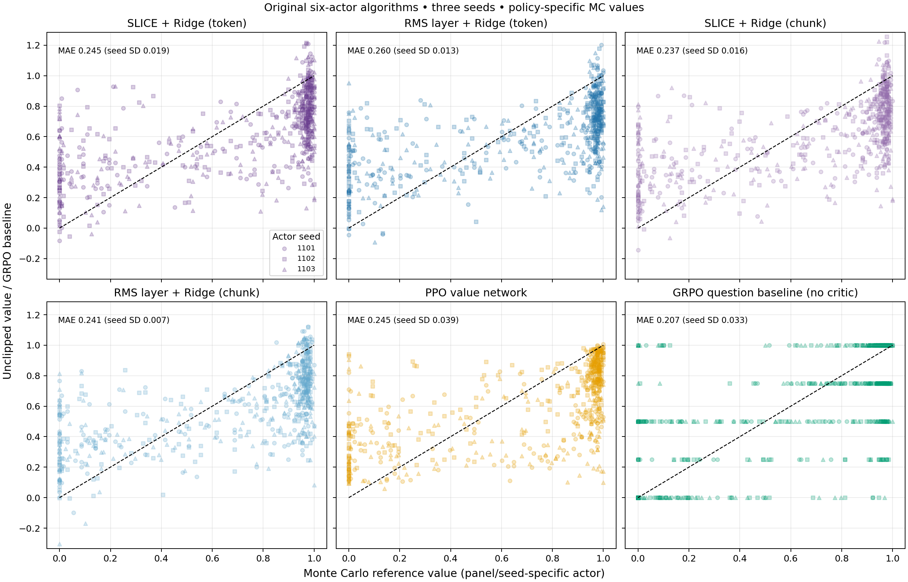

# Which learned critic best estimates its trained actor's chance of finishing correctly?

**SLICE + Ridge/chunk had the lowest observed mean learned-critic MAE, 0.23661, versus SLICE/token 0.24496 and conventional PPO 0.24499. Chunking fitted about 18× fewer states and cut SLICE's Ridge-fitting time by about 79%; total-time comparisons were affected by two persistently slow runs on the same node, so lowest overall cost and statistical superiority are not established.**

## What we measured

Six RL methods × three fresh seeds (1101–1103) gave **18 training runs**, each
with **120 updates × 64 fresh answers**. Linear critics retained one cumulative
Ridge head, epsilon .01, frozen features and normalization. Gamma was 1 and GAE
lambda .95 per token or per chunk. PPO kept its conventional GAE-return and
clipped value-loss training; MC samples were evaluation-only.

After training, each seed used **200 shared prefix states**: 50 held-out
questions with four selected prefixes each. A prompt state contains only the
question; later states include part of a generated answer. Each method's frozen
actor continued each state **128 times**, giving **460,800 reference continuations**.
The reference is the fraction receiving final verifier reward 1 within the
original 2,048-token total response cap.

These are **final-checkpoint errors**, not errors averaged over all 120 updates.
Each actor defines its own reference values, even though input prefixes match
within a seed. Question IDs match across seeds, but sampled prefixes can differ.
This measures own-policy value estimation, not six critics estimating one common
policy. Actor validation accuracy is deliberately omitted here; this study
supplies no new actor test-accuracy result.

## Value-estimation results

Lower MAE/RMSE is better. Questions receive equal weight within each seed; the
table averages three seed metrics. Predictions are not clipped.

| Estimator | Mean MAE ↓ | MAE seed SD | Mean per-seed RMSE ↓ |
|---|---:|---:|---:|
| **SLICE + Ridge / chunk** | **0.23661** | 0.01603 | **0.29351** |
| RMS two-thirds + Ridge / chunk | 0.24110 | **0.00658** | 0.29784 |
| SLICE + Ridge / token | 0.24496 | 0.01864 | 0.30396 |
| Conventional PPO transformer critic | 0.24499 | 0.03862 | 0.30928 |
| RMS two-thirds + Ridge / token | 0.25987 | 0.01332 | 0.31626 |
| GRPO question baseline (**not a learned critic**) | 0.20707 | 0.03320 | 0.30292 |

The diagonal is **y=x**, not a fitted regression line. Points above it overestimate
success; points below underestimate it. All learned critics show substantial
scatter. SLICE/chunk's observed mean advantage is modest: **0.00838 lower MAE
than PPO**, about **3.4%** relative, and **0.00835 below SLICE/token**.

### Uncertainty and consistency across seeds

Two predeclared primary contrasts used approximate paired seed/question bootstrap
intervals with Bonferroni nominal adjustment:

| MAE contrast | Mean difference | Adjusted interval |
|---|---:|---:|
| SLICE/token − PPO | −0.0000315 | [−0.03509, +0.03134] |
| RMS layer/token − PPO | +0.01487 | [−0.02366, +0.05437] |

Neither establishes a difference or equivalence. Chunk contrasts are secondary;
the supplied report does not contain their intervals. Its lowest mean is an
**observed ranking, not established superiority**. SLICE/chunk had lower MAE
than SLICE/token in all three seeds:

| Seed | SLICE/token | SLICE/chunk | PPO |
|---|---:|---:|---:|
| 1101 | 0.24649 | 0.23952 | 0.25976 |
| 1102 | 0.22560 | 0.21932 | 0.20117 |
| 1103 | 0.26279 | 0.25098 | 0.27405 |

SLICE/chunk's **MAE seed SD** was lower than PPO's and GRPO's question baseline
in these three seeds. This is less variation in this metric here, not proof of
more stable actor learning or optimization generally. RMS layer/chunk had still
lower MAE seed SD.

GRPO's baseline uses **four extra verified answers per evaluation question** and
repeats their mean across that question's prefixes. Its lower MAE does not
demonstrate a better learned prefix critic; its RMSE also exceeds SLICE/chunk's.

## Cost: reduced critic work, with a node-associated timing confound

All methods allocated two A5000 GPUs per training run. These are the original
measured means, retaining every run, including the slow ones:

| Method | Training GPUh/run ↓ |
|---|---:|
| SLICE/token | 7.886 |
| SLICE/chunk | 8.458 |
| RMS layer/token | 7.021 |
| RMS layer/chunk | 8.014 |
| PPO | 9.765 |
| GRPO | 6.070 |

Even including the slow-node run, SLICE/chunk used **13.4% less training GPUh
than PPO**. It used **7.3% more than SLICE/token** here and did not beat GRPO's
measured training cost. Prior feature learning and separate MC evaluation are
additional; these are not equal-quality total-lifecycle costs.

| SLICE component | Token mean/run | Chunk mean/run |
|---|---:|---:|
| Fitted critic states | 5,761,239 | 324,878 |
| Ridge fit, wall minutes | 1.86 | 0.40 |
| Feature/log-probability phase, wall minutes | 64.42 | 60.39 |
| Actor updates, wall minutes | 90.06 | 110.37 |

Chunking fitted about **18× fewer states**, reduced Ridge fitting by **79%**,
and saved **4.03 minutes** in the combined feature/log-probability phase. Ridge
fit is inside the advantage timer, not an additional cost. Frozen encoder
passes and actor updates still process token sequences, so fewer critic states
do not imply an 18× end-to-end speedup.

The excess total time was dominated by actor updates. SLICE/chunk seed **1102**
and RMS layer/chunk seed **1103** both ran on **`compsci-cluster-fitz-21`**,
with median actor updates **74.3/74.5 seconds** versus about **44–47 seconds**
in most other runs. The slowdown existed from update 1, when initial answer
lengths matched token counterparts. Allocations were identical: two A5000s,
eight CPUs and 128 GB memory. This strongly suggests a persistent node-associated
execution difference; its hardware/software cause is unconfirmed. No run was
excluded, corrected or replaced based on this finding.

The earlier five-seed [token/chunk study](19-token-versus-chunk.MD) measured an
**11.7% training GPUh saving** for SLICE/chunk. Together, these runs support
**potential training-time savings and clear reductions in critic work**, not a
claim that SLICE/chunk is always the cheapest. A short paired benchmark on the
same node/GPU pair would better isolate speed. The older actor test tradeoff
remains separate evidence; lower value MAE here does not overturn it.

## Practical interpretation

**SLICE/chunk is a promising compact critic when value-estimation quality and
reduced critic work matter:** it had the best observed learned-critic MAE/RMSE,
consistent MAE improvements over SLICE/token in these seeds, and lower MAE seed
variation than PPO. Token SLICE remains the established actor-accuracy baseline;
this diagnostic does not select a new actor-performance winner. Lowest overall
cost requires a controlled timing comparison.

## Evidence and limits

All three seed reports and final aggregation completed; `verification.json`
passed. Source: `outputs/numina-value-repeat-v1/main/report.txt`, user-supplied
per-seed summaries, read-only training-log timing probes and Slurm task/node
records. [Recorded numbers](../docs/results/multiseed-value-audit.json).

MC values are estimates, not exact ground truth; 128 samples have worst-case
standard error about .0442. Three seeds, 50 reused inspected questions, one
selected compressor and actor-specific targets limit generalization. Final
critics retain the recorded last-rollout/final-actor lag; Ridge retains
uncorrected historical-policy statistics. Intervals are conditional on MC
references. No new actor test evaluation is reported.

[Protocol and commands](../docs/VALUE_REPEAT.md) ·
[Implementation/comparison audit](../docs/VALUE_REPEAT_AUDIT.md).
