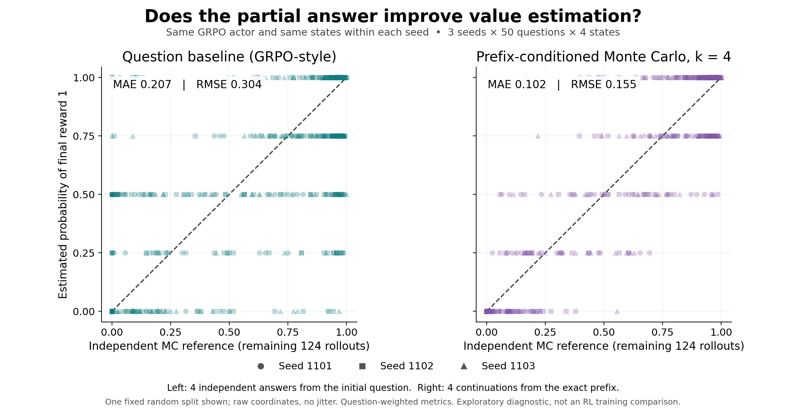

# Does conditioning on a partial answer improve a four-rollout value estimate?

**Yes in these saved GRPO-policy data: four prefix continuations achieved mean MAE 0.10073 versus 0.20709 for the independent four-answer question baseline over 2,000 repeated disjoint splits. On later prefixes alone, MAE was 0.08728 versus 0.22947, supporting useful prefix information without establishing better actor training or an equal-total-compute advantage.**

## Setup: same actor, states and reference in both panels

This is a **retrospective analysis of saved outcomes**, not new RL training or a
VinePPO training run. It uses only the GRPO actors from
[Experiment 22](22-multiseed-value-audit.MD): three actor seeds (1101–1103), the
same 50 question IDs across seeds, and four states/question/seed, giving **600
states**. Each seed's own frozen GRPO actor defines its values; prefixes can
differ across seeds.

- **Question baseline:** four independently generated complete answers from the
  initial question; their mean binary reward is reused for all its prefixes.
- **Prefix MC estimate:** randomly choose four of the 128 saved continuations
  from each exact question-plus-prefix state and average their rewards.
- **Independent reference:** average the **remaining 124** continuation rewards.
  The four estimator samples are excluded from the reference to avoid
  shared-sample agreement. Both panels use the same reference values.

Question-only states contain no generated answer. Later prefixes contain part
of the answer but exclude the next action. Continuations retain the original
remaining token budget and verifier reward rule. No new outcomes were generated,
and none were used to refit critics or update actors.

## Plot

Each panel has 600 points; marker shapes identify actor seeds. The diagonal is
ideal agreement, not a fitted line. Both estimators produce values in quarters,
but the prefix estimator's points lie much closer to the diagonal. No jitter is
applied, so overlapping points can hide their multiplicity.

The displayed split uses random seed **20261113**:

| Estimator | MAE ↓ | RMSE ↓ |
|---|---:|---:|
| Four-answer question baseline | 0.20704 | 0.30428 |
| Four-continuation prefix MC | **0.10235** | **0.15465** |

## Sensitivity to which four samples are chosen

We repeated uniform sampling without replacement **2,000 times**, using seed
1729. Each repeat partitions the same 128 saved outcomes into disjoint 4/124
sets. Errors receive equal question weight within seeds and equal weight across
the three seeds. The existing independent question baseline remains fixed.

| State subset | Question-baseline MAE | Prefix-MC MAE | Question-baseline RMSE | Prefix-MC RMSE |
|---|---:|---:|---:|---:|
| All 600 states | 0.20709 | **0.10073** | 0.30447 | **0.14893** |
| Later prefixes only: 450 states | 0.22947 | **0.08728** | 0.33453 | **0.13462** |

Values are means of repeat-level metrics. Prefix MC had lower MAE in every
repeat, both overall and on later prefixes. Its mean MAE reduction was about
**51% overall** and **62% on later prefixes**.

The central 95% split-sensitivity ranges for prefix-MC minus question-baseline
MAE were **[−0.11344, −0.09918]** overall and **[−0.14950, −0.13455]** on later
prefixes. These ranges describe re-partitioning the same finite saved outcomes;
they are **not generalization confidence intervals**, 2,000 independent
experiments, or repeated draws of the four-answer question baseline.

## Interpretation

**The partial answer provides useful information beyond question difficulty.**
The gap is especially pronounced after generation begins. This argues against
dismissing prefix-conditioned values merely because our learned critics showed
modest MAE in the earlier audit. A small-sample, Vine-style MC estimator can
capture prefix information that the question-only baseline misses here.

This does not directly rank prefix MC against the SLICE/PPO critic panels in
Experiment 22: those critics estimate their own different actors' values. Nor
does it show that state-level credit assignment improves actor learning; that
requires a controlled training comparison. Attributing the entire gap to
within-question value changes would also require separating baseline sampling
noise from those changes.

**Query costs differ:** four rollouts per state means 16 continuations per
question with four evaluated states, versus four complete answers per question
for the GRPO baseline. Continuations also have different remaining lengths, so
rollout counts are not token- or GPU-cost measurements. Saved-data subsampling
avoided new inference for this analysis; deployment would incur the queries.

## Evidence and limits

Source export: `grpo-prefix-mc-export-v1.json`, supplied from completed cluster
caches. SHA256: `02487ea9596316af668507091f248e275b191cd1a87b889b11e1883f9b70dfe3`.
Parent manifest SHA256:
`8dc4ee4ef654c2009f017ca5742bd4ccbcdbd0ff7b709a314ec2f82ddb2bfa94`.
The analysis checked 128 binary scores/state and agreement with saved sample
blocks. The full response export remains outside Git.

Three seeds, 50 reused inspected questions, a shared mixture-prefix bank and a
finite noisy reference limit generalization. This is a post-hoc diagnostic of
verifier-defined stochastic values, not exact ground truth, new actor test
accuracy, or an independently validated RL result.

[Numerical summary](../docs/results/prefix-mc-diagnostic.json).
