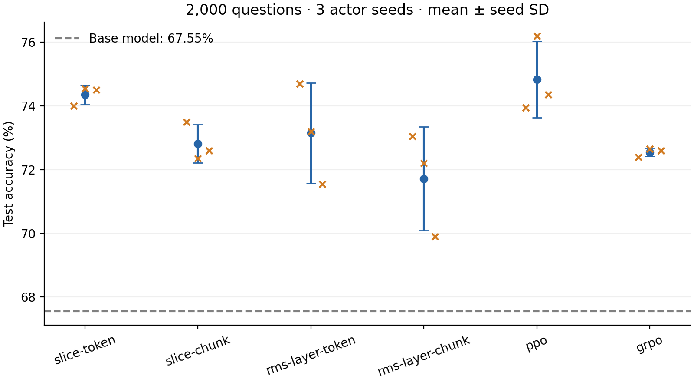
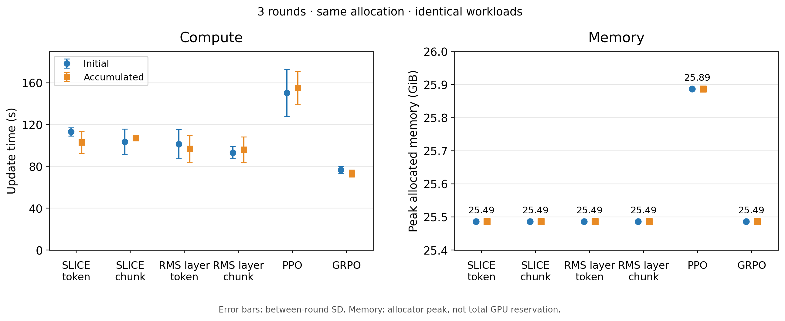
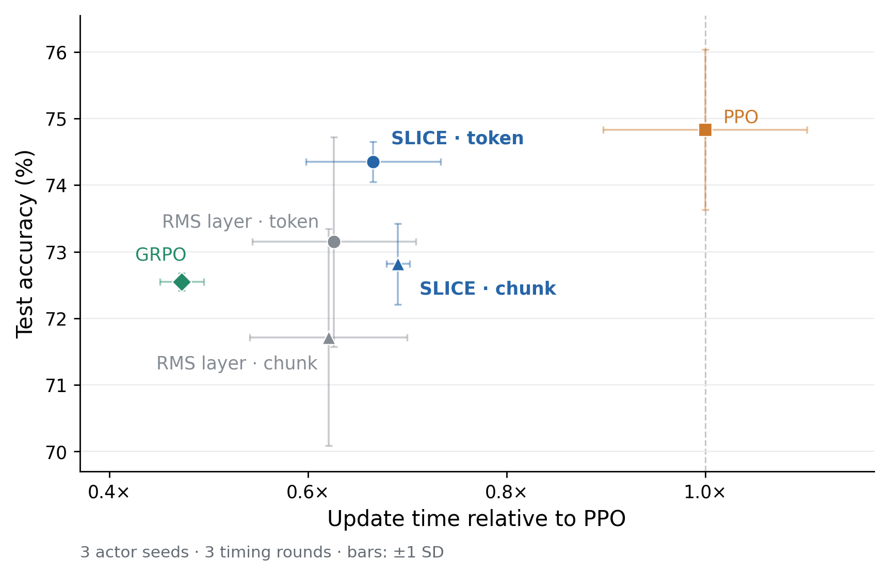

# Which tested method best balances final actor accuracy and update overhead?

**SLICE/token reached 74.35% test accuracy versus PPO's 74.83%, with 25–33% lower controlled update time; SLICE/chunk reached 72.82% with about 31% lower update time. GPU-wide telemetry showed no overall memory saving for SLICE or chunking, and chunking's time advantage over token SLICE changed sign between statistics regimes.**

## Final actor test evaluation

The 18 saved actors from [Experiment 22](22-multiseed-value-audit.MD) were each
evaluated greedily on the same 2,000 test questions, cap 2048, using the original
prompt and verifier. Three seeds 1101–1103, six methods; a fresh base reference
scored **67.55%**. These are **test**, not the earlier validation scores.

| Method | Test accuracy ↑ | Across-seed SD |
|---|---:|---:|
| SLICE/token | 74.35% | 0.30 pp |
| SLICE/chunk | 72.82% | 0.60 pp |
| RMS layer/token | 73.15% | 1.58 pp |
| RMS layer/chunk | 71.72% | 1.63 pp |
| Conventional PPO | **74.83%** | 1.20 pp |
| GRPO | 72.55% | **0.13 pp** |

The adjusted paired seed/question intervals (two predeclared contrasts) were:

- SLICE/chunk minus SLICE/token: **−1.53 pp**, interval **[−3.27, +0.15] pp**.
- SLICE/chunk minus PPO: **−2.02 pp**, interval **[−4.45, +0.33] pp**.

Chunk was lower in all three seeds, but the adjusted intervals cross zero.
SLICE/token's 0.48 pp mean gap from PPO does not establish equivalence. Its lower
seed SD is consistency in these runs, not a universal training-stability result.

## Separate controlled computational benchmark

Three randomized complete rounds ran sequentially within one allocation on the
same GPU pair. Each method processed identical saved original-token actions
from 16 training questions × four answers. Each trial discarded two warm-up
updates and measured three more. No rollout generation was timed. Initial Ridge
statistics were empty; accumulated statistics were restored from update 120.
Actors/optimizers started fresh in both regimes; PPO and GRPO have no cumulative
matrices and therefore receive repeated otherwise-equivalent trials.

| Method | Initial median update time | Accumulated median update time |
|---|---:|---:|
| SLICE/token | 113.09 s | 103.09 s |
| SLICE/chunk | 103.69 s | 106.98 s |
| RMS layer/token | 101.28 s | 96.98 s |
| RMS layer/chunk | 93.30 s | 96.13 s |
| Conventional PPO | 150.29 s | 154.89 s |
| GRPO | **76.69 s** | **73.25 s** |

SLICE/token's time reduction versus PPO was **24.8% initially and 33.4% with
restored statistics**; chunk SLICE's was about **31% in both cases**. Chunking
was **8.3% faster than token SLICE initially but 3.8% slower with accumulated
statistics**, so it did not establish a consistent overall speedup. Three timing
rounds retain substantial variability; plotted bars are SD, not confidence
intervals. No measurements were dropped based on their speed.

Logged peak allocated memory was approximately **25.49 GiB** for Ridge/GRPO and
**25.89 GiB** for PPO. This training-logger metric does not establish a large
full-pipeline memory saving; it should not be interpreted as total GPU reservation
or automatically as a per-device physical-memory measurement. Compact critic
heads and better conditioning remain distinct properties.

## GPU-wide memory follow-up

A read-only analysis of the saved `nvidia-smi` telemetry on
`compsci-cluster-fitz-17` summed `memory.used` across the **two assigned GPUs at
each timestamp**, then took the maximum simultaneous sum for each trial.
The table reports the median of those trial peaks across three rounds, separately
for each statistics regime. These are GPU-wide readings, distinct from the
training allocator peaks plotted above; the two metrics must not be combined or
treated as interchangeable estimates.

| Method | Initial median peak, both GPUs | Accumulated median peak, both GPUs |
|---|---:|---:|
| SLICE/token | 45.22 GiB | 45.22 GiB |
| SLICE/chunk | 45.22 GiB | 45.22 GiB |
| RMS layer/token | 45.22 GiB | 45.22 GiB |
| RMS layer/chunk | 45.22 GiB | 45.22 GiB |
| Conventional PPO | **44.54 GiB** | **44.54 GiB** |
| GRPO | 45.22 GiB | 45.22 GiB |

All three trial peaks within each method/regime had the same displayed value
to two decimal places. PPO's observed peak was **0.68 GiB (about 1.5%) lower**
than the others. This benchmark therefore provides **no evidence of an overall
GPU-memory saving from SLICE or chunking**. It supports lower update time for
SLICE, not a lower GPU-capacity requirement.

Smaller critic features and heads can reduce critic-specific storage without
lowering the system peak: actor training still processes every token, and common
model/cache reservations can dominate. The nearly identical readings are
consistent with that explanation, but do not identify which component caused
the peak; that requires phase/process measurements and cache-setting checks.

The telemetry was sampled approximately every two seconds and can miss brief
peaks. It covers initialization and warm-up as well as updates, includes reserved
GPU memory and any unrelated processes on those devices, and does not include
fresh rollout generation in this fixed-action benchmark. It does not measure
CPU memory or establish the minimum GPU capacity required for full training.
The numerical follow-up above was supplied from the cluster probe's printed
output; the raw telemetry remains in
`outputs/numina-controlled-cost-v1/trials/*.telemetry.jsonl` on the cluster.

## Combined tradeoff figure

The x-axis is accumulated-regime median update time divided by PPO's median;
the y-axis is mean final actor test accuracy from the separate evaluation.
Horizontal bars show timing-round SD normalized by that fixed PPO median;
vertical bars show actor-seed SD. These axes are from separate experiments,
not matched accuracy/time learning trajectories or total cost to reach accuracy.
The plot does not propagate uncertainty in the normalization denominator.

## Interpretation

**Token SLICE + cumulative Ridge remains the strongest practical default in our
paradigm:** close observed actor accuracy to PPO, substantially lower update
overhead, and lower observed actor-accuracy seed SD. GRPO is faster overall;
the normalized layer is a simple faster critic-based baseline with lower test
means. Chunk SLICE's lowest learned-critic MAE in Experiment 22 did not yield
the highest actor accuracy here. Absolute value accuracy, temporal credit
assignment and actor improvement are related but different measurements.

These results resolve the earlier node-confounded timing question more cleanly,
but do not establish cheapest full RL training to a target accuracy: generation,
feature pretraining, initialization and learning trajectories also matter. The
next [learning-curve study](25-learning-curves.MD) is designed to measure those
trajectories directly; no learning curves have been reconstructed from endpoints.

## Evidence and limits

[Test summary](../docs/results/final-test-summary.json) ·
[Cost summary](../docs/results/controlled-cost-summary.json) ·
[Protocol](../docs/TEST_FOLLOWUP.md).

Cluster: `outputs/numina-final-test-v1` (passed verification; 19 evaluation tasks)
and `outputs/numina-controlled-cost-v1` (passed verification; 36 trials).
Three seeds, previously inspected test questions, one frozen selected compressor,
one fixed benchmark workload and one GPU allocation limit generalization. Failed
benchmark smoke attempts are retained separately and not included in successful
update-time means. They remain additional project costs.
